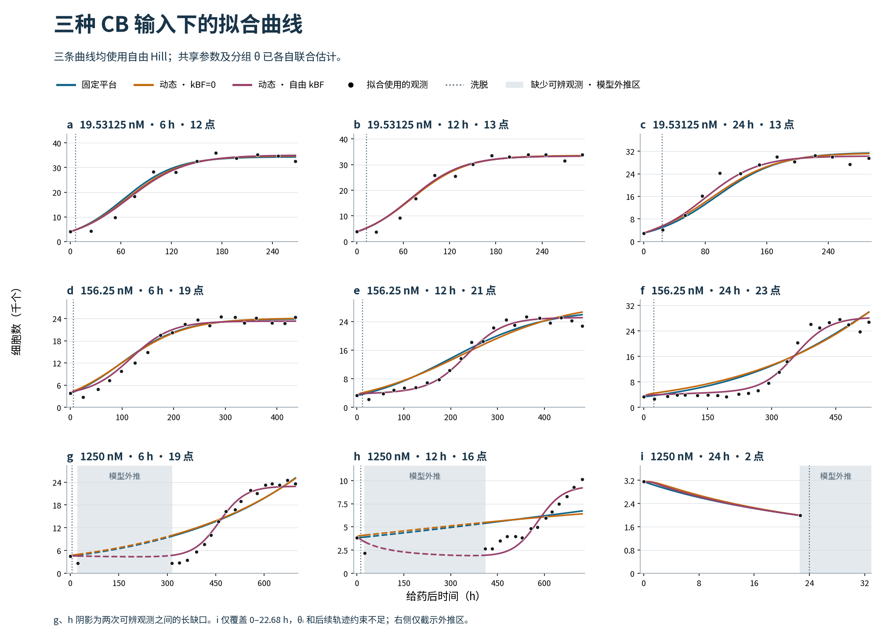
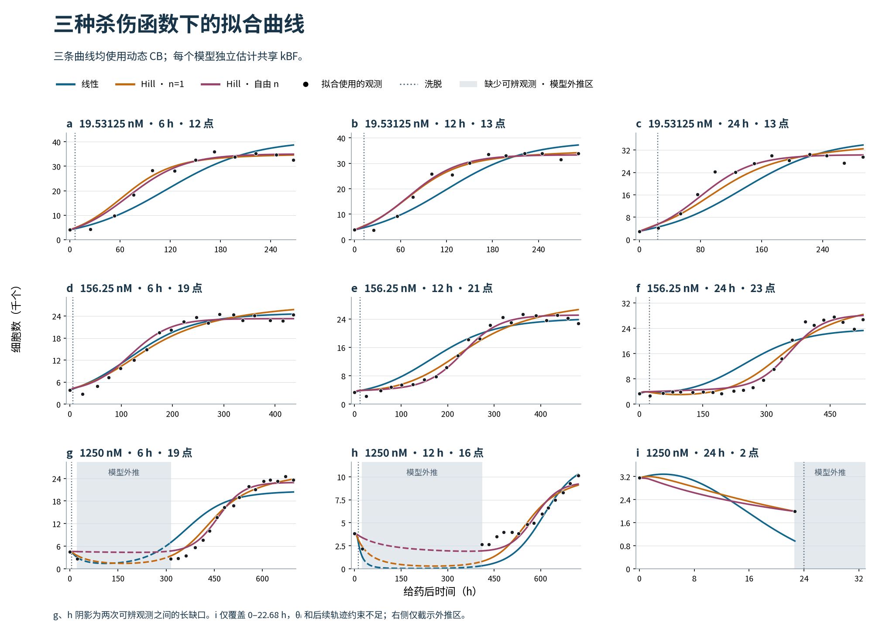
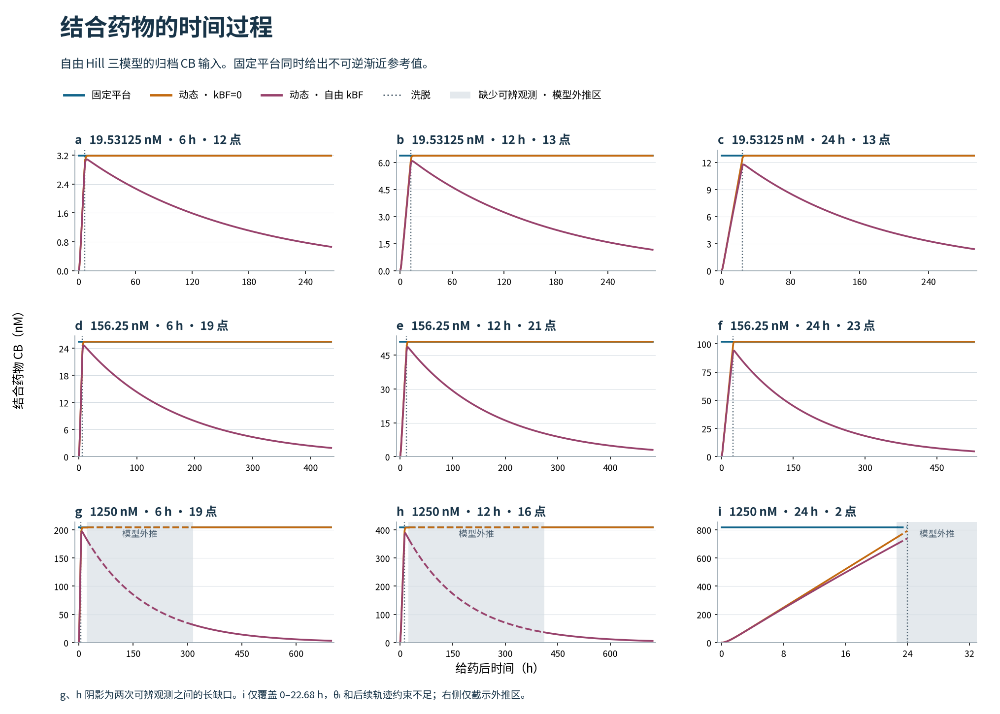
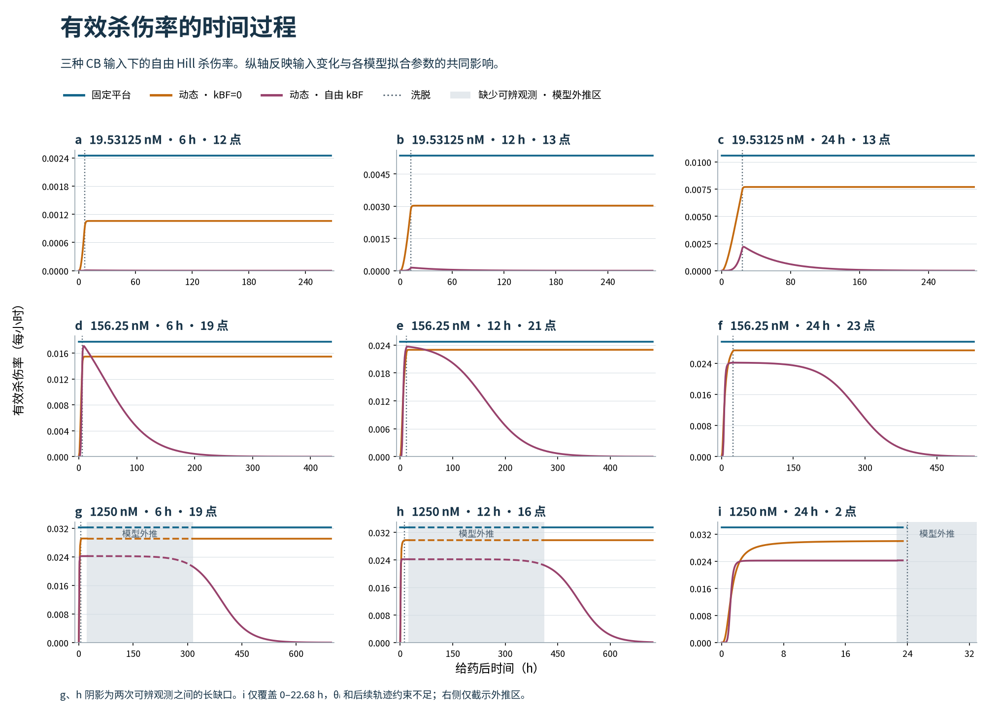

# Fig. 3 九条件模型比较

138 个可辨观测中，动态 CB 联合自由 Hill 得到最低训练 SSE 0.465522。固定平台下同一杀伤形式的 SSE 为 1.949370。两者相差 1.483848，差额的 84.3% 来自 h、g、f 三个面板。全部数值与曲线来自 `pkpd-fig3-analysis@dfcfeaf` 的 full 归档。逐条核对了观测时间、细胞数、残差、分面板及总 SSE。[汇总 PDF](fig3_full_comparison.pdf) · [原始选点](https://github.com/RainaYuWang/dox-pkpd/blob/4bfef0f4892ef1ed5e98c3c0bee5fd57cc887879/fig3/point_audit.png) · [归档总表](../full/summary.csv)

## 共享参数与最优解触界

kp、Kmax、kBF 的单位为 h⁻¹，β 为 nM⁻¹ h⁻¹，Khalf 为 nM。fixed 表示固定，— 表示不适用。固定平台由不可逆 PK 解析给出，平台模型的细胞数方程直接使用该常数。所有模型沿用固定参考参数 kEF=3.5×10⁻⁶、kFE=1.25、kFB=0.21 h⁻¹，VE=250、VI=0.004629 µL。触界按归档判据，即离搜索边界的对数距离 ≤0.01。表中各个 θ 上界均为 10⁸ cells。

| 模型 | 自由参数数 | 总 SSE | kp | β | Kmax | Khalf | n | kBF | 触界 |
| --- | --- | --- | --- | --- | --- | --- | --- | --- | --- |
| 平台·线性 | 11 | 5.436551 | 0.01691 | 3.9556e-05 | — | — | — | — | θh上 |
| 平台·n=1 | 12 | 1.954890 | 0.039115 | — | 0.040105 | 19.296 | 1 fixed | — | θg上、θh上 |
| 平台·自由 n | 13 | 1.949370 | 0.034645 | — | 0.034312 | 24.11 | 1.2683 | — | θg上 |
| 零解离·线性 | 11 | 5.557875 | 0.016673 | 3.9439e-05 | — | — | — | 0 fixed | θh上 |
| 零解离·n=1 | 12 | 2.142491 | 0.038483 | — | 0.038999 | 16.415 | 1 fixed | 0 fixed | θg上 |
| 零解离·自由 n | 13 | 2.109524 | 0.031518 | — | 0.030064 | 24.629 | 1.6189 | 0 fixed | θg上 |
| 自由解离·线性 | 12 | 2.759005 | 0.019883 | 0.00021074 | — | — | — | 0.0092416 | θi上 |
| 自由解离·n=1 | 13 | 0.796377 | 0.037161 | — | 0.05379 | 34.576 | 1 fixed | 0.0081918 | 无 |
| 自由解离·自由 n | 14 | 0.465522 | 0.029648 | — | 0.024202 | 20.11 | 4.2965 | 0.006976 | 无 |

## 各组 θ

单位为 cells，按整数展示。

| 模型 | a | b | c | d | e | f | g | h | i |
| --- | --- | --- | --- | --- | --- | --- | --- | --- | --- |
| 平台·线性 | 44,849 | 41,843 | 38,836 | 25,850 | 25,505 | 24,970 | 31,947 | 100,000,000 | 8,675 |
| 平台·n=1 | 39,879 | 44,869 | 54,010 | 57,988 | 106,680 | 413,312 | 100,000,000 | 100,000,000 | 4,811 |
| 平台·自由 n | 36,989 | 39,523 | 45,503 | 49,088 | 96,361 | 497,360 | 100,000,000 | 382,123 | 4,099 |
| 零解离·线性 | 45,345 | 42,228 | 39,214 | 25,965 | 25,649 | 25,010 | 32,402 | 100,000,000 | 1,935 |
| 零解离·n=1 | 41,103 | 47,060 | 57,899 | 64,283 | 122,497 | 458,641 | 100,000,000 | 672,871 | 4,115 |
| 零解离·自由 n | 36,026 | 37,140 | 41,567 | 47,258 | 109,665 | 1,044,810 | 100,000,000 | 148,290 | 3,289 |
| 自由解离·线性 | 40,866 | 38,832 | 36,121 | 24,939 | 24,412 | 24,138 | 20,740 | 11,663 | 100,000,000 |
| 自由解离·n=1 | 35,539 | 35,746 | 35,652 | 27,427 | 29,341 | 32,825 | 25,857 | 10,529 | 7,738 |
| 自由解离·自由 n | 35,061 | 33,340 | 30,301 | 23,275 | 25,131 | 28,356 | 22,940 | 9,426 | 2,750 |

## 各面板 SSE

残差为（预测数 − 观测数）/ 本组最大观测数，各面板 SSE 为这些残差的平方和。

| 模型 | a | b | c | d | e | f | g | h | i |
| --- | --- | --- | --- | --- | --- | --- | --- | --- | --- |
| 平台·线性 | 0.3685 | 0.3228 | 0.5296 | 0.0644 | 0.4871 | 1.585 | 1.529 | 0.5503 | 1.69e-18 |
| 平台·n=1 | 0.05451 | 0.04198 | 0.1387 | 0.06778 | 0.1661 | 0.4538 | 0.4823 | 0.5497 | 2.808e-17 |
| 平台·自由 n | 0.04707 | 0.0426 | 0.1128 | 0.07546 | 0.1642 | 0.4444 | 0.482 | 0.5808 | 5.392e-15 |
| 零解离·线性 | 0.3845 | 0.3383 | 0.5456 | 0.06369 | 0.4773 | 1.604 | 1.523 | 0.6224 | 2.07e-15 |
| 零解离·n=1 | 0.04968 | 0.04285 | 0.1335 | 0.0709 | 0.1883 | 0.5415 | 0.5078 | 0.6079 | 1.751e-15 |
| 零解离·自由 n | 0.04098 | 0.04178 | 0.09022 | 0.07909 | 0.192 | 0.5144 | 0.5053 | 0.6457 | 1.359e-13 |
| 自由解离·线性 | 0.2249 | 0.1997 | 0.4094 | 0.05856 | 0.2267 | 0.6333 | 0.5064 | 0.3938 | 0.1063 |
| 自由解离·n=1 | 0.05126 | 0.04607 | 0.1294 | 0.08792 | 0.09715 | 0.1449 | 0.0562 | 0.1835 | 1.586e-15 |
| 自由解离·自由 n | 0.03947 | 0.04394 | 0.04276 | 0.04832 | 0.03462 | 0.0912 | 0.05322 | 0.112 | 1.38e-16 |

## 两种比较

横轴从给药起算，灰色点线为 washout。g、h 的阴影跨越相邻可辨观测之间的长缺口，虚线为无观测约束的模型推演。i 面板在 22.68 h 后标为外推区，细胞数曲线止于归档的末个有效预测。i 仅有初值和一个后续计数，θ 和洗脱后轨迹的约束很弱。

固定平台搭配九个独立 θ 能调节各组的水平和单调增减速率。固定 CB 和 θ 的一维自治方程无法在同一组内先下降再回升。固定平台下，线性改为饱和 n=1 后 SSE 降 64.04%，再释放 n 只降 0.28%。保留早期 PK 过渡且 kBF=0 时，相应降幅为 61.45% 和 1.54%。动态自由 kBF 下两步分别降 71.14% 和 41.54%，参数数由 12 到 13 再到 14。

固定自由 Hill 到动态自由 Hill 的 SSE 改善，h 贡献 0.4688、g 贡献 0.4288、f 贡献 0.3532，b 略升 0.0013。动态线性改为 n=1，改善最大的是 f、g（0.4884、0.4502）。动态 n=1 到自由 n，收益最大的是 c、h、e（0.0867、0.0715、0.0625）。最低总 SSE 模型中，h（0.1120）和 f（0.0912）的残差平方和依然最大。

g 在 22.60 h 已降至约 2,656，动态自由 Hill 预测约 4,564，原始残差约 +1,909，归一化残差 +0.0777。该组 N0≈4,481，θg≈22,940。即使杀伤一直达到上限 Kmax=0.02420 h⁻¹，净人均增长率在 N=θg(1−Kmax/kp)≈4,214 时也已非负。这为从 N0 出发的轨迹设定了下限。拟合轨迹仅降至约 4,365（约 204 h，位于长缺口），在 314.38 h 仍预测约 4,726，观测约 2,656。早期失配来自这组联合参数可产生的下降幅度。早期谷值的实际时刻和深度仍待观测确认。

[固定平台时间残差](residual_1.png) · [动态 kBF=0 时间残差](residual_2.png) · [动态自由 kBF 时间残差](residual_3.png)

## CB 与杀伤率

kBF=0 时，6、12、24 h 条件在给药后约 6.57、12.09、23.48 h 达到不可逆平台的 95%。在自由 Hill 下，仅保留 PK 建立过程使 SSE 由 1.9494 变为 2.1095。允许解离后 SSE 降至 0.4655。0–48 h SSE 分别为 0.0736、0.0905、0.0544，总收益主要来自 48 h 以后。

最佳 kBF=0.006976 h⁻¹ 的模型中，a–h 从模拟峰到最后可辨观测时的 CB 分别下降 78.6%、80.9%、79.7%、92.2%、93.8%、95.0%、98.4%、98.5%。i 的末个可辨点尚在峰前。在该最佳解下，对 a–h 整个拟合窗口使用恒定平台会忽略较大的下降。以小 kBF=8.55×10⁻⁵ h⁻¹ 计算，a–h 对应下降仅约 1.85%–5.02%，此时部分后期窗口可以近似固定。[逐组平台数据](../full/platform.csv)

自由 Hill 的 29 点条件 profile 在固定 kBF 后重优化其余参数。kBF 取 0.004642、0.006976、0.01000 h⁻¹ 时，SSE 分别为 0.8871、0.4655、0.7208，对应 n 为 2.49、4.30、2.25。训练数据支持在这组候选模型中保留动态 CB，多种 PK 和杀伤参数之间仍有补偿。十个起点中五次触及优化计算预算，最佳起点收敛，最佳共享参数均处于边界内部。[条件 profile](../full/dynamic_hill_kbf_profile.csv) · [多起点](../full/dynamic_hill_starts.csv)

## 已完成与未解决

已完成九模型参数、θ、触界和误差的归档核对，以及两种叠图、残差、CB、有效杀伤率和 PDF。缺失内容包括原始逐时计数、g/h 缺口内的下降与恢复、i 的可靠 θ 和后续轨迹。对真实 CB 动态及杀伤机制的确认仍需独立测量。
