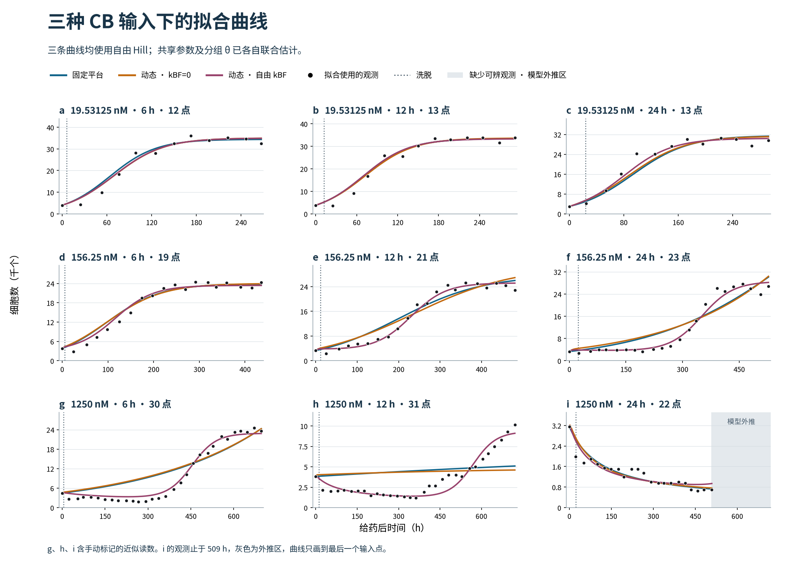
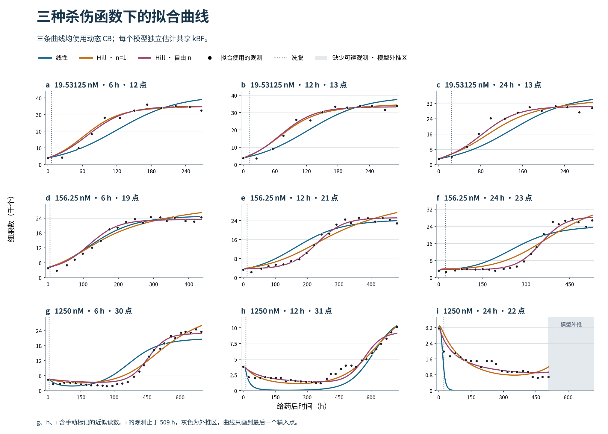

# Fig. 3 九条件联合拟合 · 184 点

SUM-149PT 的九个剂量和暴露时长组合均以给药为 0 h、以实测首点固定 N₀。保留原有 138 条数字化记录，在 1250 nM 的 g、h、i 各增加 11、15、20 条手动读数。九组分别有 12、13、13、19、21、23、30、31、22 个点。i 组观测止于 509 h。新增记录使用截图中已标记的近似时间和细胞数。[184 点](../../fig3/observations.csv) · [新增 46 点](../../fig3/manual_points.csv) · [选点核对图](../../fig3/point_audit.png) · [论文、坐标和模型说明](../../fig3/README_zh.md)

[最终模型的完整 CB(t) 和 PK 参数](cb_input/README.md) · [中文汇总 PDF](comparison/fig3_full_comparison.pdf) · [完整参数精度](full/parameters.csv) · [逐点预测与残差](full/residuals.csv) · [旧版 138 点报告及其输入版本](https://github.com/RainaYuWang/dox-pkpd/tree/4bfef0f4892ef1ed5e98c3c0bee5fd57cc887879/reports/fig3)

## 九种模型

残差为（预测细胞数 − 观测细胞数）除以本组最大观测值，每个面板的 SSE 为组内残差平方和。表内 SSE 均来自同一批 184 点。固定平台的 PK 推导取 **kBF=0 h⁻¹**（不可逆结合）。从首个细胞观测起就代入最终平台浓度，细胞数拟合没有待估的 kBF。动态零解离模型从给药开始计算 CF、CB，将 kBF 固定为 0（0 fixed）。动态自由解离模型额外用九组数据共同估计一个 kBF。kp、Kmax、kBF 单位为 h⁻¹，β 为 nM⁻¹ h⁻¹，Khalf 为 nM。组内 θ 恒定。

| 模型 | 自由参数数 | 总 SSE | kp | β | Kmax | Khalf | n | kBF | 触界 |
| --- | --- | --- | --- | --- | --- | --- | --- | --- | --- |
| 平台·线性 | 11 | 8.688146 | 0.015853 | 2.2542e-05 | — | — | — | 0（平台推导） | 无 |
| 平台·n=1 | 12 | 3.656797 | 0.038785 | — | 0.039913 | 19.9 | 1 fixed | 0（平台推导） | θg上 |
| 平台·自由 n | 13 | 3.646524 | 0.034003 | — | 0.033511 | 24.979 | 1.329 | 0（平台推导） | θg上 |
| 零解离·线性 | 11 | 8.894153 | 0.016402 | 1.7399e-05 | — | — | — | 0 fixed | 无 |
| 零解离·n=1 | 12 | 4.022635 | 0.038998 | — | 0.039384 | 15.219 | 1 fixed | 0 fixed | θg上 |
| 零解离·自由 n | 13 | 3.930409 | 0.030267 | — | 0.028569 | 26.248 | 1.8224 | 0 fixed | θg上 |
| 自由解离·线性 | 12 | 6.374532 | 0.019146 | 0.00017878 | — | — | — | 0.0081679 | θi上 |
| 自由解离·n=1 | 13 | 1.284926 | 0.036834 | — | 0.042738 | 26.372 | 1 fixed | 0.0061238 | 无 |
| 自由解离·自由 n | 14 | 0.629771 | 0.02988 | — | 0.026604 | 21.21 | 3.5671 | 0.0071555 | 无 |

θ 以细胞数计，显示为整数。θ 的搜索区间为 100 至 10⁸，近界按原流程的对数距离 ≤0.01 判断。[逐参数边界](full/bounds.csv)

| 模型 | a | b | c | d | e | f | g | h | i |
| --- | --- | --- | --- | --- | --- | --- | --- | --- | --- |
| 平台·线性 | 47,079 | 43,327 | 39,988 | 25,510 | 24,342 | 21,632 | 18,056 | 9,219 | 18,880 |
| 平台·n=1 | 39,768 | 44,594 | 53,435 | 57,139 | 104,817 | 410,721 | 100,000,000 | 752,653 | 17,660 |
| 平台·自由 n | 36,631 | 38,754 | 44,169 | 47,688 | 95,451 | 562,081 | 100,000,000 | 171,506 | 12,089 |
| 零解离·线性 | 45,607 | 42,108 | 38,565 | 24,955 | 23,359 | 19,880 | 15,630 | 6,532 | 3,970 |
| 零解离·n=1 | 41,590 | 48,115 | 60,090 | 67,647 | 132,265 | 551,662 | 100,000,000 | 233,399 | 14,541 |
| 零解离·自由 n | 35,754 | 36,053 | 39,118 | 44,359 | 111,737 | 3,792,912 | 100,000,000 | 77,678 | 8,583 |
| 自由解离·线性 | 41,671 | 39,492 | 36,787 | 25,163 | 24,697 | 24,516 | 21,091 | 12,046 | 100,000,000 |
| 自由解离·n=1 | 36,227 | 36,965 | 37,820 | 29,926 | 33,775 | 40,918 | 33,960 | 16,771 | 31,034 |
| 自由解离·自由 n | 34,997 | 33,312 | 30,427 | 23,377 | 25,192 | 28,543 | 22,875 | 9,325 | 6,540 |

## 对同一批观测的预测

两张拟合图在全部面板采用相同的时间轴（0–750 h）和细胞数轴（0–40,000 个）。黑点为拟合使用的观测，竖虚线为洗脱。灰色从各组最后一个观测时刻开始，曲线止于该时刻。i 的观测止于 509 h。残差、CB 及杀伤率九宫格也分别按同一物理量统一刻度。

### 逐面板 SSE

| 模型 | a | b | c | d | e | f | g | h | i |
| --- | --- | --- | --- | --- | --- | --- | --- | --- | --- |
| 平台·线性 | 0.4416 | 0.394 | 0.611 | 0.0621 | 0.4705 | 1.669 | 2.967 | 1.87 | 0.2024 |
| 平台·n=1 | 0.05346 | 0.04174 | 0.1375 | 0.06865 | 0.1671 | 0.4537 | 0.913 | 1.693 | 0.1285 |
| 平台·自由 n | 0.0459 | 0.04271 | 0.1075 | 0.07764 | 0.1636 | 0.443 | 0.9118 | 1.743 | 0.1118 |
| 零解离·线性 | 0.399 | 0.3485 | 0.548 | 0.06512 | 0.5461 | 1.807 | 3.106 | 1.893 | 0.1817 |
| 零解离·n=1 | 0.0501 | 0.04263 | 0.1434 | 0.07183 | 0.189 | 0.5287 | 0.9747 | 1.865 | 0.1569 |
| 零解离·自由 n | 0.03966 | 0.04025 | 0.08583 | 0.08267 | 0.1972 | 0.5118 | 0.9705 | 1.88 | 0.122 |
| 自由解离·线性 | 0.2571 | 0.2293 | 0.4461 | 0.06116 | 0.2349 | 0.6591 | 0.5503 | 0.7076 | 3.229 |
| 自由解离·n=1 | 0.04939 | 0.04593 | 0.1346 | 0.1138 | 0.161 | 0.2649 | 0.1376 | 0.093 | 0.2847 |
| 自由解离·自由 n | 0.03962 | 0.04452 | 0.04665 | 0.04908 | 0.03454 | 0.07771 | 0.06422 | 0.1584 | 0.115 |

[固定平台残差](comparison/residual_1.png) · [动态零解离残差](comparison/residual_2.png) · [动态自由解离残差](comparison/residual_3.png) · [各组观测窗口](full/observation_windows.csv) · [下降与再增长](full/regrowth.csv)

## 结果解读

**分组 θ 和固定平台。** 各组 θ 可调节增长水平和晚期细胞数。固定平台自由 Hill 的 g、h SSE 分别为 0.912、1.743。组内杀伤率与 θ 均恒定时，细胞数只能单调变化或保持水平，无法表达 g、h 的先降后升。

**饱和与解离。** 固定平台下，线性改为 n=1 降低 SSE 57.9%，再放开 n 降低 0.28%。自由解离下分别降低 79.8%、51.0%。自由 Hill 的参数数依次为 13、13、14。单独保留早期过渡且固定 kBF=0 时，SSE 为 3.9304。

**误差集中在哪些面板。** 固定平台自由 Hill 到动态自由 Hill 的总 SSE 净降幅中，h、g、f 合计贡献 92.7%。动态自由 Hill 的剩余误差以 h、i、f 面板最大。逐面板数值见上表。

**g 的整体趋势和早期偏差。** 动态自由 Hill 捕捉到后期回升，696.6 h 预测 22,804 个细胞，观测为 23,568 个。30 个点的均方根误差约为 1,137 个，相当于本组最大观测细胞数的 4.63%。 给药后 22.6 h 的观测约 2,656 个细胞，动态自由 Hill 预测 4,372 个。即使从 0 h 就达到最大杀伤率 Kmax，该时刻也至少有 4,243 个。拟合曲线到 228 h 才降至最低约 3,340 个。

**实际窗口与条件 profile。** 最佳 kBF 为 0.0071555 h⁻¹。九组末次观测时模拟 CB 较各自峰值下降 79%–99%。取相邻的 kBF 网格点 0.004642 和 0.01 并重优化其余参数后，SSE 分别为 1.1800 和 1.1774，后者 n=8.00。

**数据能支持的结论。** i 的 22 个点约束到 509 h 的变化，后续再增长、消失或长期平台仍缺少数据。手动读数尤其在近零区有误差。细胞计数支持这组模型中随时间变化的有效杀伤。真实 CB 浓度和解离速率仍需独立药物测量来验证。

g 组从 0 至 22.6 h 的观测平均对数净增长率约为 -0.0231 h⁻¹，动态自由 Hill 的对应值为 -0.0011 h⁻¹。给药初始 CB=0，杀伤从零建立，九组共享的生长和杀伤参数还要兼顾其他面板与后续恢复。所得早期净下降幅度不足。

0–48 h 的 SSE 在固定平台、零解离和自由解离的自由 Hill 模型下分别为 0.1186、0.1402 和 0.0870。早期影响包含从首点立即施加平台值和共享参数重新估计这两个因素。

g 组已取点中的最低值约为 1,800 个（267 h）。动态自由 Hill 在观测窗口内的模拟最低值约为 3,340 个（228 h）。

h 组已取点中的最低值约为 1,200 个（362 h）。动态自由 Hill 在观测窗口内的模拟最低值约为 1,401 个（350 h）。

i 组已取点中的最低值约为 650 个（459 h）。动态自由 Hill 在观测窗口内的模拟最低值约为 901 个（452 h）。

在动态自由解离模型内，从 n=1 到自由 n，SSE 降幅最大的面板依次为 f（0.1872）、i（0.1696）、e（0.1264）。h 面板单独的 SSE 由 0.0930 变为 0.1584，各组并非同步改善。

## 固定平台和动态药物过程

设 q=kEF·(VE/VI)·CE，a=kFE+kFB。不可逆结合时 CF 在洗脱后以速率 a 消退，CB 的渐近值为 q·T·kFB/a。暴露 6、12、24 h 的 α 分别约为 0.163132、0.326264、0.652527，对应首次达到渐近值 95% 在给药后 6.57、12.09、23.48 h。各组平台值只随剂量和时长改变。

| 面板 | 末次 h | 不可逆平台 nM | 最佳动态末次 CB nM | 最佳动态峰至末次下降 | 小 kBF 峰至末次下降 |
| --- | --- | --- | --- | --- | --- |
| a | 267.1 | 3.186 | 0.635 | 79.4% | 1.85% |
| b | 291.8 | 6.372 | 1.112 | 81.7% | 1.99% |
| c | 292.8 | 12.745 | 2.295 | 80.5% | 1.91% |
| d | 435.6 | 25.489 | 1.810 | 92.7% | 3.05% |
| e | 480.8 | 50.979 | 2.796 | 94.2% | 3.33% |
| f | 527.8 | 101.957 | 4.354 | 95.4% | 3.59% |
| g | 696.6 | 203.915 | 2.931 | 98.5% | 4.89% |
| h | 721.2 | 407.829 | 5.134 | 98.7% | 5.02% |
| i | 509.0 | 815.659 | 39.087 | 94.8% | 3.45% |

作为比较，忽略再结合的 600 h 尺度估计为 −ln(0.95)/600 ≈ 8.55×10⁻⁵ h⁻¹。用这个小 kBF，完整 PK 保留解离回流与再结合。在洗脱后 600 h，小 kBF 对应的峰至该时刻下降约为 4.26%，最佳自由 Hill 对应 97.41%–97.43%。从给药起算 600 h 时，最佳自由 Hill 对应 97.02%–97.32%。[CB 及平台线](comparison/cb.png) · [有效杀伤率](comparison/kill.png) · [各面板平台及参考窗口](full/platform.csv)

若把“后期近似平台”定义为**九组各自从 CB 峰值至末次细胞观测的下降均不超过 5%**，完整 PK 的小解离速率上限约为 **8.5134×10⁻⁵ h⁻¹**。计算时对各组保留回流与再结合，以洗脱后 CB′=0 定位峰值，再解 CB(末次)/CB(峰值)=0.95 并取九组最小的 kBF；限制来自 h（721.2 h）。以洗脱后 600 h 为统一终点时，相同算法给出约 1.0068×10⁻⁴ h⁻¹。两个数分别对应各自指定的窗口和 5% 容差。

三种自由解离估计均高于实际窗口的上述上限。以自由 Hill 为例，kBF=0.0071555 h⁻¹ 约为上限的 84 倍，g 的 CB 从峰至末次模拟下降 98.5%。判断放宽解离后是否仍接近平台，既要看这个比较，也要看各组实际 CB 的变化。表中浓度来自模型计算。

## 多起点和条件 profile

| 模型 | 起点数（含精化） | 最低 SSE | 最高 SSE | 距最低 <10⁻⁵ 的次数 | 达到优化预算的次数 |
| --- | --- | --- | --- | --- | --- |
| 平台·线性 | 10 | 8.688146 | 11.977697 | 9 | 0 |
| 平台·n=1 | 10 | 3.656797 | 9.238980 | 8 | 0 |
| 平台·自由 n | 10 | 3.646524 | 9.238980 | 3 | 0 |
| 零解离·线性 | 10 | 8.894153 | 18.568103 | 8 | 0 |
| 零解离·n=1 | 10 | 4.022635 | 4.022635 | 10 | 0 |
| 零解离·自由 n | 10 | 3.930409 | 3.930409 | 10 | 0 |
| 自由解离·线性 | 10 | 6.374532 | 9.056312 | 5 | 0 |
| 自由解离·n=1 | 10 | 1.284926 | 9.228950 | 8 | 2 |
| 自由解离·自由 n | 10 | 0.629771 | 9.238510 | 5 | 0 |

条件 profile 对每个正的固定 kBF 值重新估计其余共享参数和九个 θ。精确零点使用独立完成的零解离联合拟合。以下列出自由 Hill 的零点、最优点和两侧邻近网格点。

| 固定 kBF | SSE | Kmax | Khalf | n |
| --- | --- | --- | --- | --- |
| 0 | 3.93041 | 0.028569 | 26.2476 | 1.82235 |
| 0.00464159 | 1.18004 | 0.0284909 | 36.5786 | 2.07997 |
| 0.00715548 | 0.629771 | 0.0266041 | 21.2101 | 3.56707 |
| 0.01 | 1.17742 | 0.0257443 | 13.971 | 8 |

kBF=0.0100 时，重新估计的 n 达到搜索上界 8；降低 kBF 则可得到更大的 Khalf 与更小的 n。这个 profile 检验给定细胞数、固定 PK 常数及当前杀伤函数下的误差变化。[三种 profile 图](full/kbf_profiles.png) · [线性](full/dynamic_linear_kbf_profile.csv) · [Hill n=1](full/dynamic_hill1_kbf_profile.csv) · [自由 Hill](full/dynamic_hill_kbf_profile.csv)

## 运行和核对

[quick · GitHub Actions 44603046553](https://github.com/RainaYuWang/dox-pkpd/actions/runs/44603046553) 使用提交 a04281f，MATLAB R2024b Update 10 用时 92.8 秒。回传压缩包 SHA-256、141 项数值检查、9×184 条残差与 13 张图均通过核对。独立 LSODA 重算 81 对模型和条件，最大细胞数偏差除以本组最大观测值为 2.41872e-09。[完整回传包、所有起点及日志](https://github.com/RainaYuWang/dox-pkpd/tree/pkpd-results/runs/a04281f9c9031a58dfb5af74192a0c6cdf1ce208/44603046553-1) · [清单](quick/manifest.json)

[full · GitHub Actions 44603901802](https://github.com/RainaYuWang/dox-pkpd/actions/runs/44603901802) 使用提交 a04281f，MATLAB R2024b Update 10 用时 148.4 秒。回传压缩包 SHA-256、141 项数值检查、9×184 条残差与 13 张图均通过核对。独立 LSODA 重算 81 对模型和条件，最大细胞数偏差除以本组最大观测值为 2.4188e-09。[完整回传包、所有起点及日志](https://github.com/RainaYuWang/dox-pkpd/tree/pkpd-results/runs/a04281f9c9031a58dfb5af74192a0c6cdf1ce208/44603901802-1) · [清单](full/manifest.json)

九个模型的 quick 与 full 最佳 SSE 最大绝对差为 9.8e-12。

旧版 138 点与本版 184 点的观测及残差数不同，两版总 SSE 分开报告。
