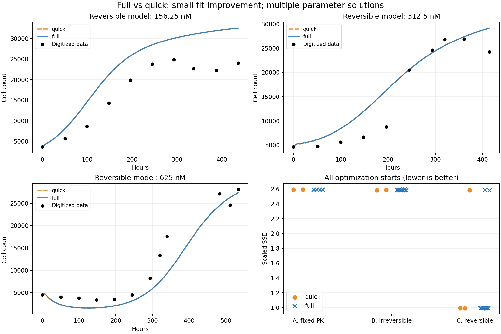

# Full 与 quick 的实际结果比较

Full 已完成，拟合质量相对 quick 只有很小改善。更多起点揭示了不同参数对应相近拟合，以及若干明显较差但仍报告收敛的解。本轮没有增加模型机制或调整参数边界。

## 实际执行及可比性

- Full：[运行 43100077010](https://github.com/RainaYuWang/dox-pkpd/actions/runs/43100077010)，提交 `39cf75bb1a459e743543a9402993aad05b2904f0`，`run_joint_pkpd(8)`，25 个起点，MATLAB 及输出检查 **73.633684 秒**。
- Quick：[运行 43099035215](https://github.com/RainaYuWang/dox-pkpd/actions/runs/43099035215)，提交 `41481687639985e2953803a3f8b96bf40426acf9`，`run_joint_pkpd(2)`，9 个起点，**22.926872 秒**。
- 两次均为 MATLAB R2024b Update 10、GLNXA64、seed=42/twister。主 MATLAB 文件与 CI MATLAB 入口逐字节一致；MAT 中的配置、内嵌数据、初始 RNG 状态一致。
- 仅为自动启动 full 扩展了工作流：`pkpd-full` 的代码 push 调用现有 full 模式，`pkpd-cloud` 保持 quick。
- Full 完成了全部 25 个中间 MAT、图片、CSV、最终 MAT 和日志输出，结果已自动回传、下载并通过 SHA-256 校验。
- Full 结果包 SHA-256：`6e5cb678a7eb7e5df98465b034ce180d4873da336c4e8de59b5693027cd328f6`。
- [Full 原始结果](https://github.com/RainaYuWang/dox-pkpd/tree/pkpd-results/runs/39cf75bb1a459e743543a9402993aad05b2904f0/43100077010-1)。

运行时间不含排队、安装及传输。日志未出现 ODE 求解警告/错误，所有起点的退出标记为 1；这不证明每次试探参数都有效或解为全局最优。

## 拟合质量

| 模型 | quick scaled SSE | full scaled SSE | SSE 相对降低 |
| --- | ---: | ---: | ---: |
| A：固定旧 PK / direct PD | 2.5914442953 | 2.5914461429 | −0.0000713%（微增） |
| B：联合不可逆 | 2.5846219890 | 2.5842013737 | 0.0162738% |
| C：联合可逆 | 0.9939678665 | 0.9939364157 | 0.00316416% |

A 的微小上升不是改变目标函数造成的。full 按原程序把对照生长拟合从 2 个起点增加到 4 个，选择的生长参数略变：

| 生长参数 | quick | full |
| --- | ---: | ---: |
| kp | 0.0310949480271856 | 0.0310949594449836 |
| theta | 35143.6077657426 | 35143.6152846162 |
| 对照 scaled SSE | 0.0177066092487775 | 0.0177066092462914 |

这些生长参数在各自运行的后续处理组拟合中固定，因而两次条件化的处理组目标函数数值会有微小区别。随机种子相同，但更多前置起点会消耗更多随机数；full 的 B/C 随机起点并非简单在 quick 的起点列表后追加。

C 的最佳曲线几乎重叠。在现有输出时间网格上，full 相对 quick 的最大绝对细胞数差分别为约 43.8、96.7、163.3 个；除以各剂量 quick 轨迹最大细胞数，分别为 0.135%、0.332%、0.597%。这是曲线间差异，不是预测误差或置信区间。

C 的分剂量 SSE 为：

| 剂量 nM | quick | full |
| --- | ---: | ---: |
| 156.25 | 0.65618409 | 0.65608051 |
| 312.5 | 0.16670357 | 0.16676133 |
| 625 | 0.17108021 | 0.17109458 |

总 SSE 的微小下降不意味着每个剂量都改善。156.25 nM 后期高估、625 nM 早期下降过深等系统偏差仍在。

## 起点是否得到相近结果

Full 的 control 4/4、A 4/4、B 8/8、C 8/8 加额外近不可逆起点 1/1，全部 `exitflag=1`。

- 对照和 A：各起点的目标函数值及参数十分接近。
- B：8 个起点的 SSE 在 **2.584201–2.593471**，相对最佳值的最大差约 **0.359%**。误差相近，参数却明显分散；其中 6/8 位于最佳 SSE 的 0.1% 以内。
- C：普通起点 1、2、3、4、6、7、8 的 SSE 在 **0.993936–0.994139**，相对差不超过约 **0.0205%**。普通起点 5 停在 **2.585673**，额外近不可逆起点停在 **2.584158**。因此是 7/9 得到接近的低误差，另外 2/9 明显较差，不能称作所有起点收敛到同一结果。

C 的七个低误差起点中，参数范围如下。这些是优化代表的范围，不是置信区间：

| 参数 | 最小值 | 最大值 | 最大/最小 |
| --- | ---: | ---: | ---: |
| kFE | 0.0946454 | 7.57134 | 80.0 |
| kFB | 0.0107229 | 1.99679 | 186.2 |
| kBF | 0.00421634 | 0.0118621 | 2.81 |
| beta | 0.000116410 | 0.0491688 | 422.4 |

模型已知存在结构性不可辨识：四个自由参数不能由细胞数唯一分开。这里还观察到有限稀疏数据对组合参数的约束较弱：quick/full 最佳代表的 `(a,b,c)` 分别约为 `(1.45864,0.00614532,1.91618e-5)` 与 `(0.664297,0.00280386,8.72700e-6)`，它们并不完全相同，因此不能把这些优化结果都说成精确的同一等价族。

另由代码专门构造的精确等价参数族，在 full 中的最大相对 N 数值差异为 `3.12898e-6`，小于现有 `1e-3` 警告阈值。它说明不同个体 PK 参数可以产生相同细胞数响应，不验证其生物学真实性。

## 哪些参数接近边界

采用代码已有的诊断尺度：`log(p/lower)<0.02` 或 `log(upper/p)<0.02`，即距边界约 2% 以内。以下“近边界”是诊断标记；列出的值多数并非数学上恰好等于边界。所有原边界保持不变。

| 模型/起点 | 近边界参数和值 | 对应边界 |
| --- | --- | --- |
| B 1 | kFE=9.99999984 | 上界 10 |
| B 4 | kFE=9.99998095 | 上界 10 |
| B 5 | kFB=9.98715844 | 上界 10 |
| B 6 | kFE=9.99994517 | 上界 10 |
| B 7 | kFE=0.000100000056 | 下界 0.0001 |
| **B 8，最佳代表** | **kFE=9.95119339；kFB=9.99997810** | **两者上界均为 10** |
| C 5，较差解 | kFE=0.000100493887 | 下界 0.0001 |
| C 额外近不可逆起点，较差解 | kFE=9.97181687；kFB=9.99999566；kBF=1.00003377e-7 | 上界 10；上界 10；下界 1e-7 |

Full 最佳可逆代表来自 C 起点 6：`kFE=0.43525879, kFB=0.22259638, kBF=0.006441831, beta=0.00020740825`，四个参数都未按上述尺度接近边界。对照和 A 也无近边界自由参数。A/B 固定的 `kBF=0` 是模型约束，不计为自由参数搜索触界。

B 的最好结果受探索边界影响的迹象明显，个体参数不宜作稳定生物学估计。C 最佳代表没有贴边也不意味着可辨识：其低误差起点仍有大范围参数变化。

## 结论与范围

更多起点增加了对解分布的认识，但没有显著改变已见拟合曲线。当前证据支持“能稳定找到相近的低 SSE 区域，同时保留多套参数及较差局部结果”，不支持个体 PK 参数唯一确定或全局最优。

处理数据仍来自论文图像数字化，旧 CF+CB 仍为模拟参考，没有独立验证集。本报告只解释本次结果，没有据此新增机制、调边界、改精度或另行拟合。

逐一起点参数、SSE、退出标记、函数评估次数、耗时及近边界标记见 [完整 CSV](full_vs_quick_all_starts.csv)。
