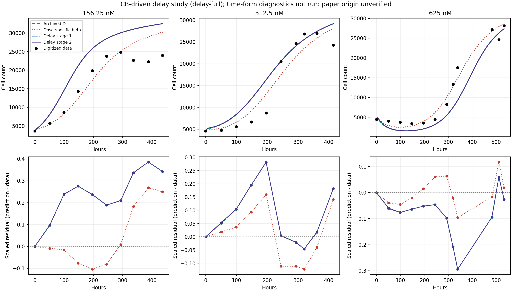
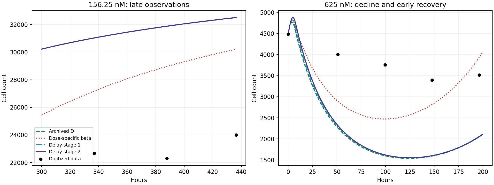
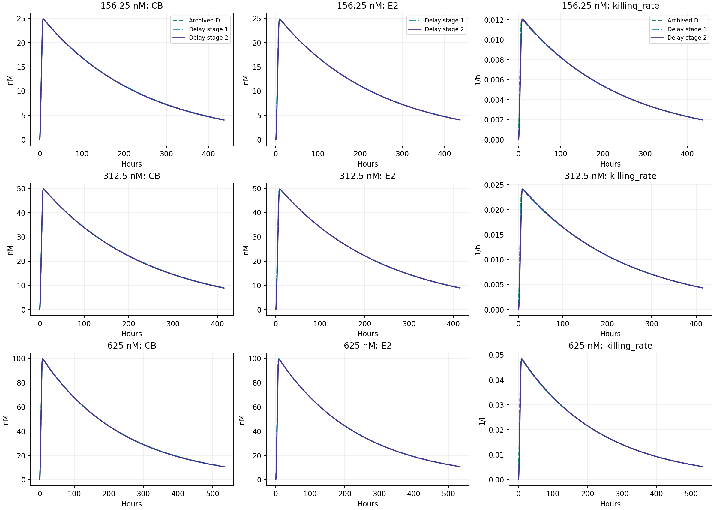
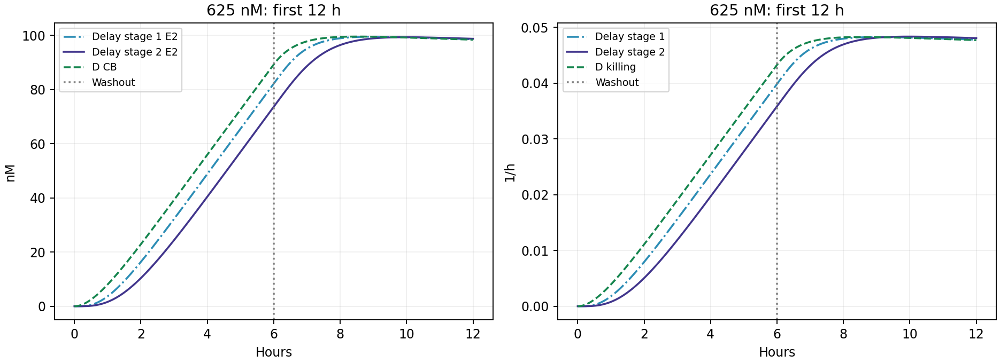
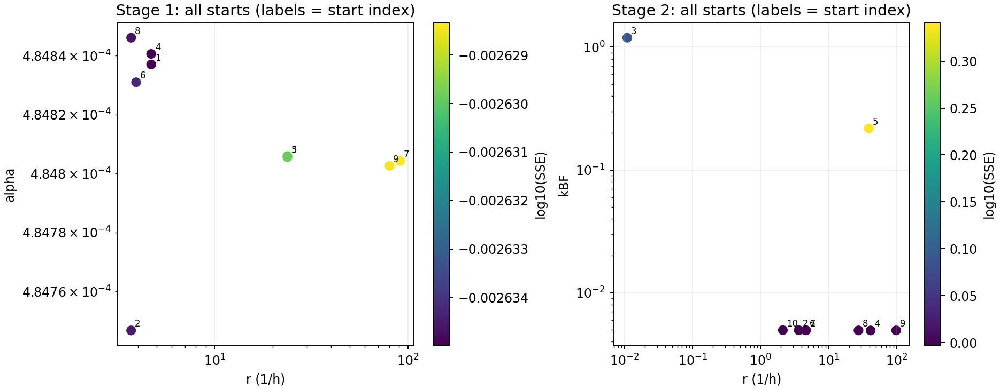
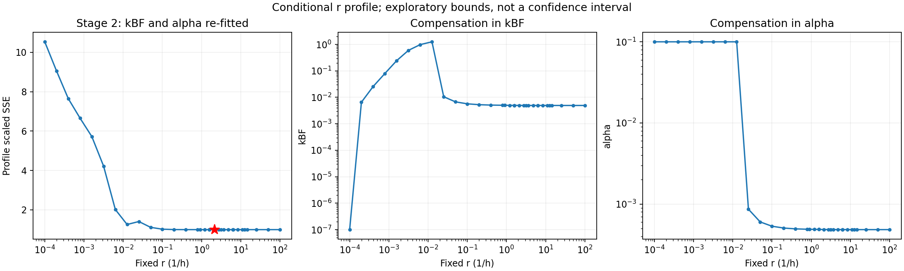
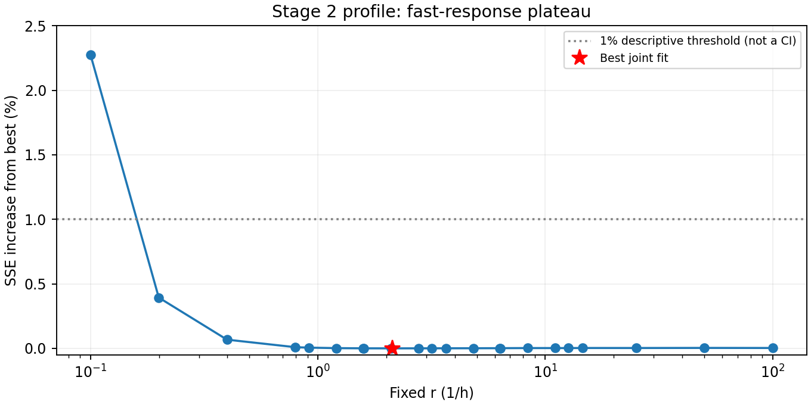

# 两级 CB 延迟 PD：实际 quick / full 结果

在本次搜索范围和现有数据下，共享的两级效应传递延迟没有实质改善模型 D。阶段 1 / 2 的训练 SSE 分别为 0.993951 / 0.993937，原 D 为 0.993969；阶段 2 的相对下降仅 0.00322%。625 nM 早期下降仍过深，156.25 nM 晚期仍明显高估。r 的条件 profile 在快速响应一侧很平坦，不能把返回的最佳 r 解释为确定的生物学延迟。

**完成范围：** GitHub → MATLAB quick 检查 → MATLAB full → Git 回传、SHA-256 校验 → 本地分析与图表均已实际执行。原文时间形式 A/B 的实现已保留，但由于原始定义尚未核实，本轮明确未运行；这部分比较仍未完成。没有默认原文 t=0 为给药开始，也没有执行新的 Ks、threshold、持续损伤或剂量相关 theta 拟合。

## 运行证据和复现

两次实际执行的源码提交均为 `f05543e978e425785fdf918751185cd1a733d300`，MATLAB 为 `24.2.0.3361896 (R2024b) Update 10`，平台 `GLNXA64`、GitHub-hosted Ubuntu 22.04。quick 成功并检查输出后才推送 full 分支。

| 模式 | Actions 运行 | 实际入口 | MATLAB 与输出检查耗时 | 状态 |
| --- | --- | --- | ---: | --- |
| delay-quick | [43137362254](https://github.com/RainaYuWang/dox-pkpd/actions/runs/43137362254) | `run_joint_pkpd(2,0,1,0,'quick')` | 130.75 s | 成功，数值与输出检查通过 |
| delay-full | [43137925939](https://github.com/RainaYuWang/dox-pkpd/actions/runs/43137925939) | `run_joint_pkpd(8,0,1,0,'full')` | 477.89 s | 成功，32 点 r profile 完成 |

工作流包装命令为 `addpath('ci'); run_pkpd_ci('delay-quick')` / `run_pkpd_ci('delay-full')`。full 整个 job（包括安装、上传及发布）约 9 min 40 s；公开 job 页面上的 MATLAB、artifact 上传、Git 发布步骤均为 success。原始 MATLAB 日志未出现 warning/error/failed 文本；这不意味着所有起点到达同一最优区域，较差局部解见下文。

full 结果压缩包 SHA-256：`b39c64c22d8ebe1e9fd6bcd07d42c478c2b105e0d7cfdb1df8f8d1c2d5f593d3`。本地已取回至 `cloud-results/f05543e978e425785fdf918751185cd1a733d300/43137925939-1/`，含 MATLAB 日志、CSV、MAT、全部优化起点和 profile 检查点。原始包可从 Actions 的 `pkpd-delay-full-43137925939-1` artifact 下载，或使用持久保存的 [Git 结果包](https://github.com/RainaYuWang/dox-pkpd/blob/pkpd-results/runs/f05543e978e425785fdf918751185cd1a733d300/43137925939-1/results.zip)；无需手动下载即可用以下命令取回。

```bash
python3 ci/collect_results.py --sha f05543e978e425785fdf918751185cd1a733d300 --mode delay-quick --run-id 43137362254
python3 ci/collect_results.py --sha f05543e978e425785fdf918751185cd1a733d300 --mode delay-full --run-id 43137925939
python3 ci/analyze_model_d_delay.py \
  --results cloud-results/f05543e978e425785fdf918751185cd1a733d300/43137925939-1/joint_results \
  --quick-results cloud-results/f05543e978e425785fdf918751185cd1a733d300/43137362254-1/joint_results \
  --output reports
```

分析脚本依赖 numpy、matplotlib，只读取结果，不重新拟合。本报告的延迟比较 PNG 在结果取回后生成，随报告提交保存；原始 Actions artifact 保持当次运行输出。后续已提交的模型修改可依次 push 至 `pkpd-delay-quick`、通过后 push 至 `pkpd-delay-full`，各使用 `--sha HEAD --mode delay-quick/delay-full --wait 5400` 收集。当前代码已经运行过，重复推送同一提交不会产生新 push 事件；需要重跑同一代码时可在 Actions 选择 `delay-full`。代码及文献定义 JSON 有路径过滤，普通文档修改和 main 推送不启动计算。

## 文献核实的外部限制

仓库和工作区未找到 DOI `10.1038/s41598-017-05902-z` 的正文或 supplementary，现有选点图片及 README 不能补全定义。Nature 原文和 Europe PMC DOI 查询在本环境 HTTPS CONNECT 阶段均返回代理 HTTP 403（server: envoy），未取得正文。

因此以下五项仍未核实：A/B 的时间原点、D 的定义、theta(D) 的形式与拟合、初始细胞数的处理、拟合区间及处理前观测。详见 [文献核查记录](paper_definition_audit.md)。时间形式诊断 A / B 的输出状态分别为 `not_run_unverified_paper`，SSE 为缺失值，不是拟合失败或 SSE=0。原有 PK 模型 A/B/C 与这里的原文时间形式 A/B 是不同的比较对象。

限于 Nature、Springer 补充材料、Europe PMC/PMC 的网络配置草案已保存；当前环境仍为 revision 1，自定义允许域名为空，草案尚未应用。要完成文献部分，需要在当前云环境设置 → 网络访问 / 自定义允许域名中审核并保存/发布该草案；不需要 GitHub token。域名清单及缺失定义均已记录，取得原文后应带出处更新 `paper_time_definitions.json`、正确映射当前数据轴，再执行 quick/full。当前不把这些比较称为原文复现。

## 比较条件、参数与训练 SSE

保留 32 个处理组数字化观测、时间轴、各剂量首点 N0、残差 `(预测-观测)/该剂量最大观测值` 以及平方和。两个延迟阶段都使用相同的参考 PK、生长参数；washout 只将 CE 从给药浓度变为 0，所有状态连续。

固定值及来源如下。参考 PK 不是独立实验已确定的值，原 notebook 未随仓库提供，最早可核实代码来源为提交 `6325d45` 的 `run_joint_pkpd.m` 第 26–27 行；更早来源的限制见 [模型 D 定义](model_d_definition.md)。

| 固定量 | 数值 | 单位/来源 |
| --- | ---: | --- |
| kEF | 3.5e-6 | h^-1，最早代码 cfg |
| kFE | 1.25 | h^-1，最早代码 oldFE |
| kFB | 0.21 | h^-1，最早代码 oldFB |
| VI / VE | 0.004629 / 250 | µL，最早代码 cfg |
| kp | 0.031094959444983555 | h^-1，full 运行 43100077010 的 control_start_04.mat |
| theta | 35143.615284616222 | cells，同一对照组 full 结果 |
| 阶段 1、分剂量 beta 的 kBF | 0.0049373889028291049 | h^-1，归档 D 运行 43101764836 的 model_d_fit.mat |

最后一项来自同一细胞数数据上的瞬时 PD 拟合，不是独立 PK 测量。保存的 MAT 已核对 quick/full 的 cfg、生长参数、32 个观测及边界完全一致。

| 比较模型 | 本轮自由参数数 | 参数结果 | 总训练 SSE |
| --- | ---: | --- | ---: |
| 归档线性 D | 0；原拟合为 2 | kBF=0.0049373889，beta=0.00048479872 | 0.99396925495 |
| 分剂量 beta 诊断 | 3 | beta=0.00088625614 / 0.00056372244 / 0.00042453955 | 0.32394513275 |
| 原文时间形式常数杀伤诊断 | 计划 3 | 未运行：定义未核实 | — |
| 原文时间形式暂时杀伤诊断 | 计划 6 | 未运行：定义未核实 | — |
| CB 延迟阶段 1 | 2 | alpha=0.00048483696，r=4.6887233；kBF 固定 | 0.99395110667 |
| CB 延迟阶段 2 | 3 | kBF=0.0049674457，alpha=0.00048674566，r=2.1298567 | 0.99393720526 |

beta/alpha 单位为 nM^-1 h^-1，kBF/r 为 h^-1。分剂量 beta 的顺序为 156.25、312.5、625 nM。所有模型均另以已拟合的 kp/theta 为共同固定条件；不能把这些历史估计当作外部已知量来夸大自由度优势。本轮不进行 AIC 加权。

阶段 1 的 alpha 沿用 beta 边界 `[1e-9,0.1]`；阶段 2 的 kBF 沿用 `[1e-7,10]`；r 的探索范围为 `[1e-4,100] h^-1`，对应核峰值延迟 10000–0.01 h。该范围覆盖相对观测窗口很慢到很快的效应，不是实验不确定性区间。正参数采用原有对数变换，multifit/fminsearch 设置和 ODE 精度保持不变。完整方法见 [延迟模型定义](model_d_delay_definition.md)。

quick 阶段 2 的 r=3.65091、SSE=0.99394371527；full 经 profile 引导细化后为 r=2.12986、SSE=0.99393720526。SSE 仅再降低 6.51e-6，r 却改变约 42%，再次说明不能依赖单次最优参数的小数位。阶段 1 的 quick/full 最佳结果一致。quick 只用于数值和流程检查；本报告结论以 full、全部起点和条件 profile 为依据。

## 各剂量曲线和残差

| 模型 | 156.25 nM SSE | 312.5 nM SSE | 625 nM SSE |
| --- | ---: | ---: | ---: |
| D | 0.656189 | 0.166709 | 0.171071 |
| 分剂量 beta | 0.190987 | 0.096877 | 0.036082 |
| 延迟阶段 1 | 0.655883 | 0.167130 | 0.170938 |
| 延迟阶段 2 | 0.656081 | 0.166770 | 0.171086 |



残差定义为预测减观测。D 和延迟模型的系统性形状几乎重合：156.25 nM 在所有非初始观测均高估，后期高估尤其明显；312.5 nM 在约 50–196 h 高估、293–320 h 轻度低估、末点再高估；625 nM 在约 51–482 h 多数明显低估，339 h 附近低估约 8.3 千，511.5 h 转为正残差、末点再为负。

| 模型 | 156.25 nM：t≥300 h 平均残差（cells，3 点） | 625 nM：0–200 h 最低预测 N / 时刻 | 625 nM：t≥300 h 平均残差（cells，5 点） |
| --- | ---: | --- | ---: |
| D | +8812.75 | 1538.96 / 124.09 h | −3173.44 |
| 分剂量 beta | +5794.09 | 2471.33 / 99.06 h | +20.18 |
| 延迟阶段 1 | +8806.38 | 1552.15 / 124.61 h | −3185.53 |
| 延迟阶段 2 | +8814.59 | 1552.74 / 125.13 h | −3160.96 |

625 nM 的数字化观测最低点为 3393.94 cells / 147.88 h；这是离散观测最低点，不是已测定的连续轨迹极小值。表中预测最低点取自保存的密集网格，时刻精度受网格限制。



延迟阶段 2 只把 625 nM 谷底提高约 14 个细胞、推迟约 1 h，仍远低于相邻观测；低剂量晚期平均高估反而增加约 2 个细胞，属于几乎不变。全时间输出网格上，阶段 2 相对 D 的最大细胞数差异在三个剂量分别约 49、113、198 cells。阶段 1 的最大差异约 26、52、92 cells。

分剂量 beta 诊断确实降低训练 SSE，但没有消除时间残差：低剂量中期偏低、晚期偏高；312.5 nM 仍有早正、中负、末正的形状；625 nM 的早期负残差减小却仍存在，晚期残差也正负交替。因此其晚期平均残差接近 0 不代表各时点均拟合准确，更不构成跨剂量预测模型的验证。

## CB、效应传递与实际杀伤时间

五个物理状态为 CF、CB、E1、E2、N；数值上沿用 log(N) 积分以保持正值，不人为截断细胞数。E1/E2 与 CB 均为 nM，只称为效应传递状态，不解释为已测量 DNA 损伤或特定分子机制。

零初值下，`E2(t)=∫CB(s) r²(t−s) exp[−r(t−s)] ds`。核的积分为 1、峰值延迟为 1/r、均值延迟为 2/r。阶段 1 / 2 的核峰值延迟分别为 0.213 / 0.470 h，均值延迟为 0.427 / 0.939 h。实际输入下 CB 约在 8.55 h 达峰，E2/有效杀伤约在 9.05 / 9.95 h 达峰；这些峰时不等于 1/r。峰时来自 0.05 h 网格。

| 模型 | 156.25 / 312.5 / 625 nM 最大有效杀伤率（h^-1） |
| --- | --- |
| 延迟阶段 1 | 0.0120628 / 0.0241256 / 0.0482512 |
| 延迟阶段 2 | 0.0120851 / 0.0241702 / 0.0483404 |





延迟主要推迟给药后最初数小时的杀伤建立，对几十至数百小时的长尾改变很小。第一条非初始细胞数观测约在 50.91 h，因此不能把亚小时级最佳延迟读成被早期数据精确测定的量。

这一线性 PK + 共享线性传递结构仍使 E2(t) 及杀伤率随剂量成比例，三个剂量共享同一时间形状。它增加了一种共同的时间调整能力，不能独立调整各剂量的时间形状。此次结果只表明这种具体扩展未修复现有偏差；不能推论所有时间形状扩展都无效，也不能在原文对照未完成时宣布原文暂时效应假设得到检验。

## 多起点、边界与 kBF/r 补偿

阶段 1 有 8 个常规起点和 1 个大 r 起点；阶段 2 同样有 9 个初始拟合，另由 profile 最好区域进行 1 次联合细化。32 个固定 r 点各重新优化 kBF、alpha 3 起点，共 96 次条件拟合。每起点都有参数、SSE、exitflag、函数评估次数、耗时和 MAT 检查点；较差解没有删除。

阶段 1 的 9 个起点均 exitflag=1、无触界，SSE 为 0.9939511–0.9939663，但 r 分散在 3.6907–91.1237 h^-1，alpha 仅在约 0.000484747–0.000484846 之间变化。曲线近似稳定而 r 明显不稳定。

阶段 2 的 10 个结果均 exitflag=1，其中 8 个在 SSE≈0.993937–0.993966 的平坦区域，另两个较差局部解为：

| 起点编号 | kBF | alpha | r | SSE | 边界 |
| --- | ---: | ---: | ---: | ---: | --- |
| 3 | 1.193116 | 0.100000 | 0.0109445 | 1.225127 | alpha 上界 |
| 5 | 0.217564 | 0.0164366 | 39.1072 | 2.190917 | 未近边界 |

大 r 起点（编号 9）停在 r=98.8586，接近搜索上界，SSE=0.9939662。最佳阶段 1 / 2 参数均未触界。触界判据为距任一边界的对数距离 <0.02（约 2%）；阶段 1 的 kBF 固定，不属于其拟合触界诊断。成功退出只说明优化器的停止条件满足，不证明全局最优。







在采样的 profile 点中，r 从约 0.1995 到上界 100 h^-1 均处在最佳 SSE 的 1% 以内，对应 kBF 约 0.0049375–0.0052836、alpha 约 0.000484774–0.000507203。这是描述性的采样范围，不是置信区间或连续区间的严格界限。即使固定 r=100，SSE=0.9939663 也几乎等于最佳值，未出现有说服力的快速端约束。

将 r 从 100 降到 0.1 h^-1（核峰值延迟从 0.01 增至 10 h），重拟合后的 kBF 从约 0.004942 升至 0.005698、alpha 从约 0.0004851 升至 0.0005341，SSE 升至 1.01654。这反映更快药物消退和更强杀伤可以部分补偿更慢效应传递，但并非任意程度的延迟都可等价补偿。r≤0.012589 的本次 profile 结果触及 alpha 上界；最慢点还触及 kBF 下界，SSE 明显更高。不能把这些受边界影响的较差解解释为已确定真实长延迟不存在。

上述近最优区域的 SSE 差异极小，profile 局部亦有微小不平滑；本轮保留原 ODE/优化精度，没有为精确排列这些微小差异而修改精度。因此参数小数位用于复现，不用于声称生物学精确性。有限多起点和 profile 也不是全局最优证明。

## 数值检查与未改变的设置

quick/full 都在真实 MATLAB 中通过以下检查；误差均为最大绝对差除以参考曲线最大值，不是逐点相对误差。

| 检查 | 三剂量中最大误差/结果 |
| --- | --- |
| alpha=0 恢复解析 logistic | 1.2311e-6 |
| r=1e4 h^-1 时 N 对瞬时 D | 1.5740e-6 |
| r=1e4 h^-1 时 E2 对 CB | 3.3547e-5 |
| CF/CB/E1/E2 对独立分段矩阵指数解 | 1.3176e-7 |
| washout 全五状态连续 | 跳变为 0 |
| washout 导数变化仅来自 CE→CF | 核对误差为 0 |
| 最佳输出及测试状态 | 非负，N>0；没有人工截断 |

大 r 极限测试的 1e4 在拟合边界外，仅用于数值对应检查，不参与参数搜索。r=1、100、1e4 时，N 对瞬时结果的最大归一化差依次约 1.53e-2、1.57e-4、1.57e-6，随 r 增大减小。RelTol=1e-7、AbsTol=1e-9；fminsearch MaxIter=650、MaxFunEvals=1800、TolX=1e-5、TolFun=1e-8，全都沿用原设置。原 CF/CB 方程、数据、残差、已有边界和生长条件没有改动。

本轮对训练 SSE 的微小改善、r 的弱约束、与较差局部解的区别均已保留。没有新增独立实验或留出数据，不能据此声称预测能力获验证；旧 CF+CB 模拟也未作为独立约束使用。

## 文件与结果索引

- `run_joint_pkpd.m`：五状态 ODE、两阶段多起点、r profile、数值检查，以及受原文核实状态控制的时间形式诊断。
- `ci/run_pkpd_ci.m`：delay-quick/full 入口、固定量与状态检查、失败状态和日志保存。
- `.github/workflows/matlab-pkpd.yml`：两种 delay 模式和计算分支、路径过滤及超时；本轮未运行饱和模式。
- `ci/collect_results.py` / `ci/publish_results.py`：按源码 SHA、模式、可选 run ID 匹配回传结果，避免同提交 quick/full 混淆。
- `ci/analyze_model_d_delay.py`：从真实 MATLAB CSV 重建残差、局部曲线、状态/杀伤峰、起点及 profile 图，不重新拟合。
- `reports/paper_time_definitions.json` / `paper_definition_audit.md`：未核实项及外部网络限制；README 中无原始依据的时间原点断言已改为现有模型输入约定。
- [参数](delay_parameters.csv)、[模型汇总](delay_summary.csv)、[各剂量 SSE](delay_by_dose.csv)、[逐时残差](delay_residuals.csv)、[局部指标](delay_metrics.csv)、[相对 D 曲线差](delay_curve_changes.csv)、[效应峰值](delay_effect_peaks.csv)、[quick/full](delay_quick_full.csv)。
- [阶段 1 起点](delay_stage1_starts.csv)、[阶段 2 起点](delay_stage2_starts.csv)、[r profile](delay_stage2_r_profile.csv)、[数值极限检查](delay_numerical_checks.csv)、[矩阵指数检查](delay_matrix_exponential_checks.csv)、[机器可读诊断汇总](delay_diagnostics.json)。

下一步尚待完成的是原文与补充材料定义核实及对应时间形式诊断；本轮没有自动叠加任何新机制。
