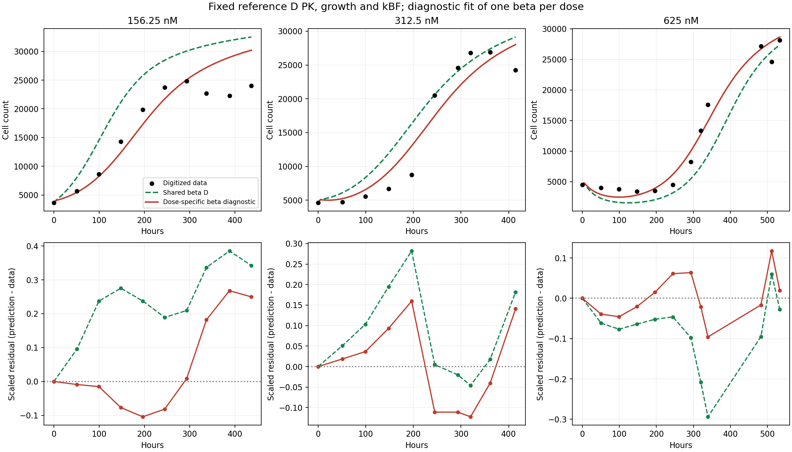
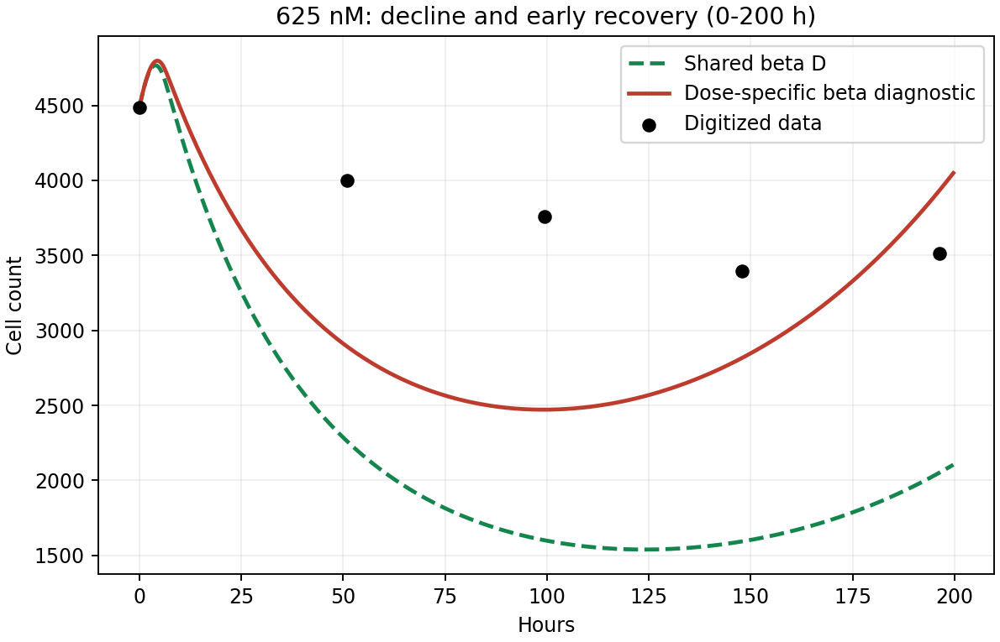

# 模型 D：共享 beta 与分剂量 beta 的诊断比较

分剂量 beta 使训练 SSE 降低 **67.41%**，但没有消除低剂量晚期高估，也没有消除 625 nM 早期下降过深。它表明共享 beta 对本批数据的拟合有明显影响；残差的时间模式仍然存在，不能仅靠误差下降判定机制更合理。

## 已完成的实际 MATLAB 运行

- 成功运行：[43130155204](https://github.com/RainaYuWang/dox-pkpd/actions/runs/43130155204)，代码提交 `8651970481d212cc935db0204c455ca89a494e52`。
- GitHub-hosted Ubuntu 22.04，MATLAB R2024b Update 10 / GLNXA64；命令 `addpath('ci'); run_pkpd_ci('dose-beta')`，内部 `run_joint_pkpd(8,false,true)`。
- GitHub 页面显示本次运行耗时 **4 分 28 秒**。MATLAB 加输出检查 **152.161 秒**；包含原 A/B/C/D、D 条件 profile，以及本次诊断。三个剂量拟合及局部审计计时合计 **6.378 秒**，不包括绘图、安装、排队及上传。
- 已经由 `pkpd-results` Git 分支自动取回状态、日志、CSV、MAT、PNG 和每起点检查点。结果压缩包 SHA-256：`618214acdd43b8f9c398037363a531e94b1de418a4fbe27d31a8ce5e5d4a021c`。

固定参考参数 kEF=3.5e-6 h^-1、kFE=1.25 h^-1、kFB=0.21 h^-1、VI=0.004629 µL、VE=250 µL，来源为原始代码提交 `6325d45`；固定 full 对照组 kp=0.031094959444983555 h^-1、theta=35143.615284616222 cells。固定原模型 D 最佳 kBF=0.0049373889028291049 h^-1，共享 beta=0.00048479871747565857，完整双精度值取自运行 `43101764836` 的 `model_d_fit.mat`，不是从展示用 CSV 舍入值恢复。来源限制见 [D 定义](model_d_definition.md)，本次设置见 [诊断定义](model_d_dose_beta_definition.md) 和 [固定值 CSV](model_d_dose_beta_fixed.csv)。

共享比较和分剂量诊断使用相同的 32 个处理组观测、每剂量最大观测值残差缩放、原 SSE 求和方式、beta 边界 `[1e-9,0.1]`、原 ODE、6 h washout 以及 ode15s 的 RelTol=1e-7、AbsTol=1e-9。没有改变数据、求解精度或增加机制。

## beta 与训练误差

beta 的单位为 nM^-1 h^-1，使 beta·CB 为 h^-1。每剂量 8 起点，使用相同的 `161803/twister` 随机起点集合；各 beta 独立拟合与固定其余参数后联合最小化总 SSE 等价。

| 剂量 (nM) | 分剂量 beta | 相对共享 beta | 共享 beta SSE | 分剂量 beta SSE | SSE 下降 | RMSE：共享 → 分剂量 (cells) |
| --- | ---: | ---: | ---: | ---: | ---: | ---: |
| 156.25 | 0.000886256 | 1.8281 | 0.65618870 | 0.19098701 | 70.89% | 6365 → 3434 |
| 312.5 | 0.000563722 | 1.1628 | 0.16670933 | 0.09687656 | 41.89% | 3474 → 2649 |
| 625 | 0.000424540 | 0.8757 | 0.17107123 | 0.03608156 | 78.91% | 3358 → 1542 |
| 总计 | — | — | **0.99396925** | **0.32394513** | **67.41%** | — |

较低剂量需要更大的 beta，625 nM 需要较小的 beta；但不能把这一排序当作已确定的生物学剂量关系。完整数值见 [拟合汇总](model_d_dose_beta_summary.csv) 和 [误差/最低点指标](model_d_dose_beta_metrics.csv)。

## 残差随时间的形状

残差定义为预测减观测：正值为高估，负值为低估。下图下排采用原目标函数中的缩放残差；连接相邻观测点只是帮助观察形状，不代表进行了连续残差观测。



**156.25 nM：早中期高估大幅减轻，晚期高估保留。** 原共享模型在除初值外的所有观测点均高估。独立 beta 后，50.9–244.8 h 残差转为负值，约 −222 至 −2587 cells；293.3 h 接近零；337–436 h 又持续高估，约 +4519 至 +6658 cells。387.9 h 的高估由 +9574 降为 +6658 cells，仍很明显。196.4 h 则由 +5903 变为 −2587 cells。因此，共享 beta 造成的部分偏差被减轻，但没有同时拟合好中期增长及晚期平台/回落。

**312.5 nM：仍呈“早期正、中期负、末期正”的结构。** 50.9–196.4 h 仍高估，196.4 h 残差由 +7589 减为 +4295 cells；244.8–361.2 h 转为连续低估，320 h 为 −3293 cells；414.5 h 再次高估 +3787 cells。降低整体 SSE 同时把部分偏差转移到了恢复阶段，并未消除时间形状不匹配。

**625 nM：早期低估减轻，但仍存在；恢复阶段也有正负交替。** 50.9、99.4、147.9 h 的分剂量模型仍低估，残差分别为 −1106、−1286、−577 cells；196.4–293.3 h 转为高估；320–482.4 h 的观测点又低估，339.4 h 为 −2694 cells；511.5 h 高估 +3300 cells。平均残差虽然更接近零，但连续的同号区段和较大局部误差仍值得关注。

全部有符号残差、预测值和观测值见 [逐时残差 CSV](model_d_dose_beta_residuals.csv)，未删去任何不利时间点。

## 625 nM 的下降是否仍过深



| 比较量 | 共享 beta D | 分剂量 beta 诊断 | 数字化观测 |
| --- | ---: | ---: | ---: |
| 50.9 h 细胞数 | 2263 | 2894 | 4000 |
| 99.4 h 细胞数 | 1601 | 2471 | 3758 |
| 147.9 h 细胞数 | 1593 | 2817 | 3394 |
| 输出网格最低细胞数 | 1539 | 2471 | 最低观测点 3394 |
| 对应最低点时间 (h) | 124.1 | 99.1 | 最低观测点 147.9 |

分剂量 beta 减小约 12.4%，将最低细胞数抬高，但 99.4 h 仍比同一时刻观测低约 **34.2%**，147.9 h 仍低约 **17.0%**。因此“下降过深”仅得到部分改善。模型最低点还提前了约 25 h。观测稀疏且来自图像数字化，最低观测点不是精确的真实连续最低点；这里只报告预测最低点与已观测形状的差异。

## 收敛、边界与数值限制

24 个起点均返回 exitflag=1，全部 beta 均未触及或接近原边界（沿用对数距离 0.02 的近界判据）。312.5 和 625 nM 的起点 SSE 极差分别约 4.37e-11、1.82e-10。低剂量起点得到两组非常接近的值：beta 约 0.000886255 与 0.000886920，最大相对差约 0.075%，SSE 极差约 5.52e-7。这远小于本次总 SSE 改善，但 beta 的末位数字不宜作科学解释。

首次运行 [43129468749](https://github.com/RainaYuWang/dox-pkpd/actions/runs/43129468749) 的拟合完成，随后因低剂量多起点与独立一维扫描的 SSE 差超过最初 1e-7 检查阈值而被标记失败；已有输出已自动保存。复跑增加各剂量最优区域的 101 点局部审计并包含两种最优值，未发现有实质影响的更低 SSE。低剂量局部采样可见约 1e-6 量级的细小起伏，当前数值计算不支持区分这些极接近的 beta。

诊断输出一致性判据调整为 SSE 差小于 1e-6，且 beta 对数差小于 0.001；这不是改变 ODE 或优化器容差。保留原 `fminsearch` 最佳结果，一维扫描及局部网格用于审计，没有用更宽边界或新目标替换原拟合。复跑后全部检查通过，三个最佳 beta 和 SSE 与首次拟合相同。

[起点结果](model_d_dose_beta_starts.csv)、[运行诊断](model_d_dose_beta_diagnostics.json)、[低剂量局部目标函数](model_d_dose_beta_dose_01_local_objective.csv) 均已保存。固定 kBF 下的收敛不代表参数被唯一确定。

## 解释边界与复现

固定 PK 后，同一剂量的 CB(t) 保持一致，独立 beta 只改变有效杀伤项的幅度，不能独立控制不同时间段的杀伤形状。此次比较支持“共享 beta 约束对拟合偏差有贡献”，同时显示“仅放宽 beta 仍不能充分匹配全部时间形状”。没有拟合 beta 与剂量的函数，也没有据此将诊断推广到未观测剂量或给药方案。

在固定 kBF 的条件比较中，自由 beta 从 1 个增加到 3 个。kBF 本身来自同一训练数据，不能当作独立实验已知参数。训练误差下降不能单独证明机制更合理或预测能力提高。数据来自论文图像数字化，旧 CF+CB 为模拟值，不是额外实验约束或验证集。本次不引入 threshold、damage-memory 或其他机制，原 A/B/C/D 继续保留，分剂量 beta 仅作诊断。

本次修改包括 `run_joint_pkpd.m` 的可选诊断、`ci/run_pkpd_ci.m` 的运行检查、工作流的 `dose-beta` 模式，以及从实际 MATLAB 输出重建图表的 `ci/analyze_model_d_dose_beta.py`。Python 分析不执行拟合。

从仓库根目录自动取回并复现本报告图表（Python 依赖 numpy、matplotlib）：

```bash
python3 ci/collect_results.py --sha 8651970481d212cc935db0204c455ca89a494e52 --wait 1800
python3 ci/analyze_model_d_dose_beta.py \
  --results cloud-results/8651970481d212cc935db0204c455ca89a494e52/43130155204-1/joint_results \
  --output reports
```

新运行可手动选 Actions 的 `dose-beta` 模式，或将相关代码提交推送至 `pkpd-dose-beta`，再用 collector 按精确提交号自动取回。完整原始结果同时保留在该次 Actions 的 `pkpd-dose-beta-43130155204-1` artifact 和 Git 结果分支中；报告/文档提交只推送 main，不触发重复计算。
