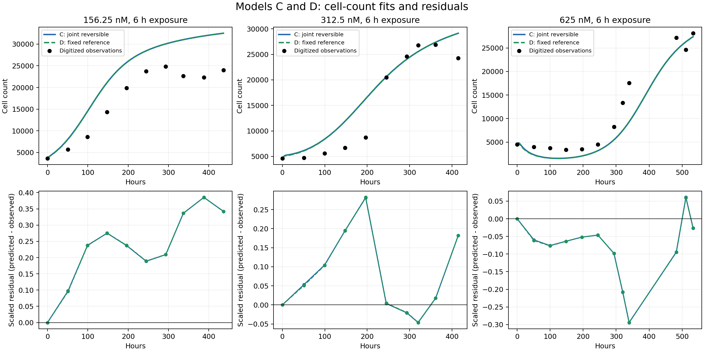
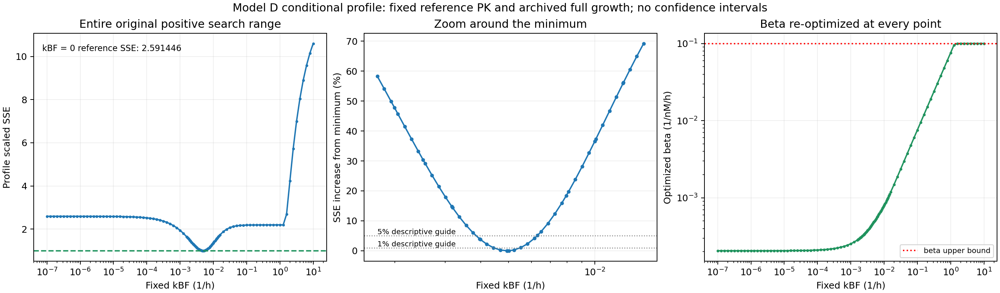

# 模型 D：实际 MATLAB 运行、C/D 比较及 kBF 条件 profile

模型 D 用两项跨剂量共享的自由参数取得了与 C 几乎相同的细胞数拟合。固定其他参考参数后，kBF 的条件 profile 在约 0.00494 h^-1 处出现低谷；这不是对参考参数真实性或真实解离速率唯一性的验证。

## 代码来源与固定值

| 参数 | 固定值 | 单位 | 可核实来源 |
| --- | ---: | --- | --- |
| kEF | 3.5e-6 | h^-1 | 最早模型提交 `6325d45`，`run_joint_pkpd.m` 的 cfg，第 26 行 |
| kFE | 1.25 | h^-1 | 同一提交 cfg.oldFE，第 27 行 |
| kFB | 0.21 | h^-1 | 同一提交 cfg.oldFB，第 27 行 |
| VI | 0.004629 | µL | 同一提交 cfg，第 26 行 |
| VE | 250 | µL | 同一提交 cfg，第 26 行 |
| kp | 0.031094959444983555 | h^-1 | full 运行 `43100077010` 的对照拟合 MAT |
| theta | 35143.615284616222 | cells | 同上 |

[原始代码](https://github.com/RainaYuWang/dox-pkpd/blob/6325d45431e5fd663a9965d45e1889f620c54e76/run_joint_pkpd.m#L26)直接包含五项 PK/体积参考值；README 称其来自 `Project_reproduction(2).ipynb`，VI 是旧模型校准的有效体积。当前仓库未包含该 notebook，无法进一步核实其校准过程。固定这些值是本次比较的条件，不表示它们由独立 PK 实验确定。

生长参数取自上一轮 full 的 `control_start_04.mat` 中 best，采用可还原原 double 的 17 位数字。新运行的 gD 与归档值逐位一致；A/B/C 的代表参数和 SSE 也与上一轮 full **完全一致**。

## 实际运行与输出

- [GitHub Actions 43101764836](https://github.com/RainaYuWang/dox-pkpd/actions/runs/43101764836)，代码提交 `950b8e52466c0bc98cff98ce759eea70c5b1929b`。
- MATLAB R2024b Update 10，Linux；命令 `addpath('ci'); run_pkpd_ci('full')`，内部 `run_joint_pkpd(8)`。
- 完成 33 个联合拟合起点（原 A/B/C/对照 25 个 + D 8 个）及 **124 个 profile 点**。
- MATLAB 和输出检查耗时 **153.825609 秒**，不含安装、排队和传输。
- 结果已自动回传、下载并核对 SHA-256；[结果分支及 ZIP](https://github.com/RainaYuWang/dox-pkpd/tree/pkpd-results/runs/950b8e52466c0bc98cff98ce759eea70c5b1929b/43101764836-1)。
- CI 成功；profile 最小值与 D 联合拟合 SSE 相差约 `1.34e-12`。kBF=0、重新优化 beta 的 profile 参考点 SSE 与 A 相差约 `1e-13`。

原 ODE、washout、数据、残差定义和 ODE 容差均未改。D 的自由边界为 kBF `[1e-7,10]`、beta `[1e-9,0.1]`；A/B/C 拟合顺序及随机数使用未改变。

## D 与 C 的拟合

| 模型 | scaled SSE |
| --- | ---: |
| A：固定旧 PK / direct PD | 2.5914461429 |
| B：联合不可逆 | 2.5842013737 |
| C：联合可逆 | 0.9939364157 |
| D：固定参考，仅拟合 kBF、beta | 0.9939692550 |

D 比 C 高 `3.28392e-5`，即 **0.003304%**，曲线和残差几乎重合。在这批数据上，释放 kFE/kFB 带来的目标函数改善极小；这既不能验证参考 PK 值，也不能替代误差模型下的正式模型比较。

D 的最佳共享参数为：

- `kBF = 0.0049373889028291 h^-1`
- `beta = 0.000484798717475659 nM^-1 h^-1`

两者均远离本次搜索边界。D 的 7/8 个起点收敛到几乎同一解：SSE 差异不到 `3e-11`，kBF 在 `0.0049373806–0.0049374114`，beta 在 `0.0004847977–0.0004847999`。
第 7 个起点虽然 exitflag=1，却停在 `kBF≈3.9483e-7, beta≈0.0785408`、SSE=`13.58012535`。这个 SSE 与“除 t=0 外预测细胞数全部为零”的目标函数值吻合到约 `1e-13`，符合在过强杀伤、近零预测的数值平坦区域停止；不能把这个退出标记当作找到了好的解。profile 的全范围 beta 扫描与细化没有保留这个劣解。

## 各剂量残差与细胞数曲线

残差仍定义为“预测 − 观测”，按本剂量最大观测细胞数缩放。RMSE 的单位为 cells。

| 剂量 nM | C scaled SSE | D scaled SSE | C RMSE | D RMSE |
| --- | ---: | ---: | ---: | ---: |
| 156.25 | 0.65608051 | 0.65618870 | 6364.708 | 6365.233 |
| 312.5 | 0.16676133 | 0.16670933 | 3474.935 | 3474.393 |
| 625 | 0.17109458 | 0.17107123 | 3357.852 | 3357.623 |

D 在 156.25 nM 略差，在另外两剂量略好；变化量很小。系统残差模式保持不变：

- 156.25 nM：处理后观测点基本持续被高估，后期残差约 +8400 至 +9600 cells。
- 312.5 nM：早期至约 200 h 多为正残差，随后短暂低估，再出现末期高估。
- 625 nM：多数时段为负残差，模型早期下降过深、回升时段仍低估，最大负残差约 −8263 cells（D）。

两模型在输出时间网格上的最大绝对细胞数差分别约 **44、97、164 cells**；除以各剂量 C 轨迹的最大细胞数，分别为 **0.135%、0.333%、0.599%**。这些比例比较的是两条模型曲线，不是相对于真实细胞数的预测误差。

## kBF profile：每点重新优化 beta

固定参考值和已归档 kp/theta 后，扫描原 kBF 范围 `1e-7–10 h^-1`，并在 D 最佳点附近加密；额外保留 kBF=0 作为不可逆参考。每个点均在完整 beta 边界内扫描 log(beta)，再细化检测到的最小值区域，并比较端点。方法及输出字段详见 [定义文档](model_d_definition.md)。

124 点中，115 点选择细化优化器的成功结果；9 点选择显式测试的 beta 上界（flag=2，不是优化失败）。没有保留未细化的扫描候选。最佳 profile 点为 `kBF≈0.004937389, beta≈0.00048479835`，SSE=`0.993969254951`。

| 固定 kBF (h^-1) | 重新优化的 beta | profile SSE |
| --- | ---: | ---: |
| 0，不可逆参考 | 0.000205882 | 2.591446 |
| 0.0001 | 0.000210324 | 2.519144 |
| 0.001 | 0.000253598 | 1.940388 |
| 0.004937389 | 0.000484798 | 0.993969 |
| 0.01 | 0.000795470 | 1.357565 |
| 0.1 | 0.00754837 | 2.183076 |
| 1 | 0.07573455 | 2.194760 |
| 10 | 0.1（上界） | 10.604099 |

最佳点附近有明确的条件低谷。为描述其宽度，以 **SSE 相对最小值上升 1%、5%、10%** 作人为标尺，按相邻网格点在 log(kBF) 轴上线性插值，得到约：

| 描述性 SSE 上升限度 | kBF 范围 (h^-1) |
| --- | --- |
| 1% | 0.00443–0.00550 |
| 5% | 0.00385–0.00629 |
| 10% | 0.00345–0.00696 |

这些是网格插值的条件性曲线宽度，**不是置信区间或统计显著性界限**；切勿将 1%、5%、10% 误读为置信水平。网格内每个固定 kBF 都实际重新优化了 beta，插值交点本身未额外求解。

高 kBF 时，beta 必须随之增大以补偿更快解离。在本次网格的 `kBF≥1.584893 h^-1` 的 9 个点，beta 已达上界 0.1，此后的 profile 陡升部分受 beta 搜索边界限制，不能把高端全部曲率归因于数据。最佳点附近 beta 约为 `4.85e-4`，远离两端，因此局部低谷并非 beta 贴边制造。

## 如何解释约束程度

在 D 的固定假设下，改变 kBF 会改变已知参数组合：`a=1.46+kBF`、`b=1.25*kBF`，beta 则控制 `c=beta*kEF*(VE/VI)*0.21`。本次条件 profile 显示，beta 重新优化不能完全补偿 kBF 偏离约 0.00494 的影响。

这与 C 的个体参数不可辨识并不矛盾：D 通过固定 kFE/kFB 等量取消了原先可相互补偿的自由度。若释放这些参考值，或传播生长参数、读图和固定量的不确定性，D 的这条条件 profile 不能直接沿用。不能据此称 kBF 为实验唯一确定的真实解离速率。

处理组细胞数仍来自论文图像数字化，全部用于拟合；旧 CF+CB 仍只是模拟参考，不是验证集。本轮未加入新机制，也未改动参数边界。

[完整 profile CSV](model_d_kbf_profile.csv) · [D 各起点 CSV](model_d_multistart.csv) · [固定值与来源 CSV](model_d_fixed_parameters.csv) · [C/D 分剂量 CSV](model_d_vs_c_by_dose.csv)
