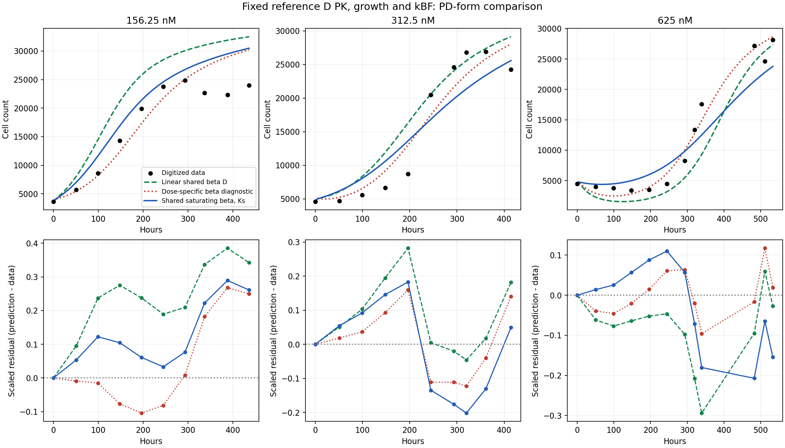
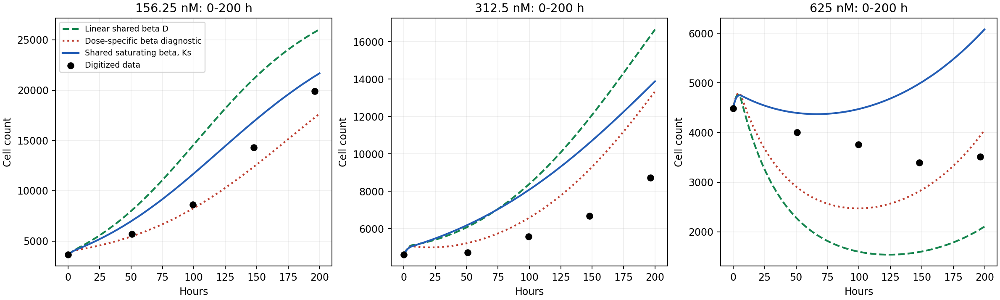
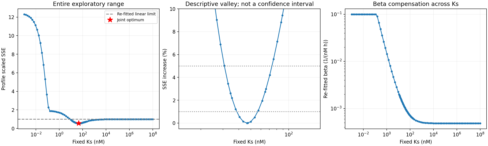

# 固定模型 D PK 的共享饱和杀伤项：第一轮结果

共享饱和项得到 **beta=0.0009323445 nM^-1 h^-1、Ks=46.6188 nM**，训练 SSE 为 **0.55170775**，较原共享线性 D 降低 **44.49%**，但高于分剂量 beta 诊断的 **0.32394513**。有限 Ks 在本次条件 profile 中有约束，最优解没有趋向线性极限。

改善不均匀：低剂量高估减轻但保留，312.5 nM 的 SSE 反而增加 5.10%；625 nM 的早期下降从过深变为过浅，晚期持续低估。总 SSE 降低不能概括为各剂量时间形状均得到改善。

## 实际运行和固定条件

- 成功的 GitHub-hosted MATLAB 运行：[43132525453](https://github.com/RainaYuWang/dox-pkpd/actions/runs/43132525453)，科学计算代码提交 `1c95e5f49f598b0fea35e06165d1076cb9e7a16d`。
- MATLAB R2024b Update 10 / GLNXA64，命令 `addpath('ci'); run_pkpd_ci('saturation')`，内部 `run_joint_pkpd(8,false,true,true)`。
- GitHub 页面显示 **6 分 10 秒**；MATLAB 加输出检查 **111.882 秒**。新增饱和拟合、Ks profile 及其输出部分约 **36.9 秒**，其中 9 个联合优化起点约 **7.454 秒**。运行总时间还包含原 A/B/C/D、D 的 kBF profile 和分剂量 beta 诊断；安装与 MATLAB 计时分开。
- 已自动读取状态、日志和全部结果，ZIP SHA-256 为 `54504652328d65c811e107e44de15caf42be8cc4881d85b093d0460d7fa8a000`。原线性和分剂量 beta 的 SSE 与归档结果一致。

固定 kEF=3.5e-6 h^-1、kFE=1.25 h^-1、kFB=0.21 h^-1、VI=0.004629 µL、VE=250 µL；固定 kp=0.031094959444983555 h^-1、theta=35143.615284616222 cells、kBF=0.0049373889028291049 h^-1。已从本次 MAT 核对：参考参数、初始条件、输入和数据均与归档 D 完全一致。保留三状态、6 h washout、原目标与残差缩放、ode15s 的 RelTol=1e-7 和 AbsTol=1e-9。没有加入 threshold、damage-memory 或重拟合生长/PK 参数。

参数来源和边界设计见 [本轮定义](model_d_saturation_definition.md) 及 [原 D 来源](model_d_definition.md)。旧 CF+CB 模拟曲线未加入拟合目标。

## 参数、单位和边界

杀伤速率为 `E(CB)=beta*CB/(1+CB/Ks)`，细胞数方程中的杀伤项为 `-E(CB)*N`。

| 参数/派生量 | 最佳值 | 单位 | 探索边界与说明 |
| --- | ---: | --- | --- |
| beta | 0.0009323445 | nM^-1 h^-1 | `[1e-9,0.1]`，沿用原 beta 边界 |
| Ks | 46.6188 | nM | `[1e-3,1e8]`，覆盖强饱和至近线性 |
| beta*Ks | 0.0434648 | h^-1 | 派生最大杀伤速率，没有额外独立边界 |

CB=Ks 时，杀伤速率为最大值的一半。参考 PK 下三剂量 CB 峰值约 24.889、49.778、99.556 nM；Ks 下界远小于这些峰值，上界高出最大峰值约一百万倍。因此覆盖范围足够用于本轮饱和/线性比较，但它是计算探索范围，不是实验不确定性范围或生物学先验。最佳 beta、Ks 均未接近边界。

## 训练 SSE 与原比较模型

| 剂量 (nM) | 共享线性 D | 分剂量 beta 诊断 | 共享饱和 beta/Ks | 饱和相对线性变化 |
| --- | ---: | ---: | ---: | ---: |
| 156.25 | 0.65618870 | 0.19098701 | 0.24084780 | 降低 63.30% |
| 312.5 | 0.16670933 | 0.09687656 | 0.17521596 | 增加 5.10% |
| 625 | 0.17107123 | 0.03608156 | 0.13564399 | 降低 20.71% |
| 总计 | **0.99396925** | **0.32394513** | **0.55170775** | **降低 44.49%** |

在 kBF 固定的条件下，三者拟合的 PD 参数数分别为 1、3、2。饱和模型的总 SSE 比分剂量 beta 诊断高约 70.31%，三个剂量的 SSE 也都高于该诊断。分剂量线性 beta 与共享饱和形式不是彼此嵌套的模型；不同参数数目和不同时间响应形式均影响这一比较。



## 各剂量时间残差和晚期偏差

残差为预测减观测。下述形状来自全部原观测点；没有删去不利时间点或改变权重。

**156.25 nM：高估减少，但仍贯穿整个观测期。** 饱和模型除初值外的所有残差仍为正。99.4 h 高估约 3039 cells；244.8 h 高估约 822 cells；337–436 h 再增至约 +5524 至 +7191 cells。晚期平台/回落的形状仍未匹配。

**312.5 nM：早期高估，恢复阶段低估，最后一点转正。** 50.9–196.4 h 的残差为正，196.4 h 约 +4913 cells；244.8–361.2 h 连续为负，320 h 约 −5422 cells；414.5 h 为 +1341 cells。恢复阶段偏差加大，导致该剂量总 SSE 比原共享线性 D 增加约 5.1%。

**625 nM：早中期转为高估，晚期持续低估。** 50.9–293.3 h 的观测点残差全部为正，147.9 h 约 +1591 cells，244.8 h 约 +3096 cells；320 h 之后的全部观测点为负，范围约 −5826 至 −1822 cells，最后 533.3 h 为 −4343 cells。原先的下降过深并未转化为正确的下降和恢复形状。

晚期统一定义为 **t≥300 h 的观测点**，未用于重新加权或拟合。每格为“平均有符号残差 / RMSE”，单位 cells；平均值接近零可能来自正负抵消，因此同时报告 RMSE。

| 剂量 (nM)；晚期点数 | 共享线性 D | 分剂量 beta | 共享饱和 beta/Ks |
| --- | ---: | ---: | ---: |
| 156.25；3 | +8813 / 8829 | +5794 / 5867 | +6401 / 6438 |
| 312.5；3 | +1380 / 2928 | −195 / 2964 | −2531 / 3809 |
| 625；5 | −3173 / 4753 | +20 / 1949 | −3813 / 4144 |

625 nM 的晚期 RMSE 比线性 D 小，但平均低估更大且全为负值，不能只凭 RMSE 称晚期偏差消失。[逐时残差 CSV](model_d_saturation_residuals.csv)、[各剂量 SSE/RMSE](model_d_saturation_by_dose.csv)、[最低点与晚期指标](model_d_saturation_metrics.csv) 均已保存。

## 早期最低细胞数（0–200 h）

| 剂量 (nM) | 共享线性 D：最低 N / 时刻 | 分剂量 beta：最低 N / 时刻 | 共享饱和：最低 N / 时刻 |
| --- | ---: | ---: | ---: |
| 156.25 | 3636 / 0 h | 3636 / 0 h | 3636 / 0 h |
| 312.5 | 4606 / 0 h | 4606 / 0 h | 4606 / 0 h |
| 625 | 1539 / 124.1 h | 2471 / 99.1 h | **4371 / 66.2 h** |



625 nM 初值约 4485 cells，饱和模型只比初值下降 **2.53%**；最低数字化观测为 **3394 cells，147.9 h**，比初值低约 24.3%。在该观测时刻，饱和模型预测 **4985 cells**，已开始回升。故本次最佳饱和拟合将“下降过深”改成了“下降过浅且过早恢复”。观测点稀疏，最低观测点不等于已精确测量的连续最低点；上述比较用于描述可见的时间形状。

这种转变与杀伤函数本身一致。拟合 beta 约为原共享 beta 的 1.923 倍；两个函数在 CB≈43.04 nM 时杀伤速率相等。高 CB 时饱和模型降低杀伤，CB 降至该值以下时则比原线性 D 杀伤更强。因此，它能压低高剂量早期杀伤，同时增强后期尾部的影响。这是方程和本次参数的解释，不是对机制的实验验证。

## Ks 是否有约束，以及线性极限

共计算 **124 个 Ks profile 点**，每点重新优化共享 beta。联合最优 Ks≈46.62 nM，profile 最小 SSE 与联合拟合一致。Ks=Inf 时重新优化得到 beta≈0.0004847978、SSE≈0.993969255，比有限最优高约 80.16%。因此，在当前固定条件下，拟合偏好有限 Ks，没有仅靠推向线性极限来降低 SSE。

下面是已采样 profile 中，SSE 不超过最小值指定百分比的有限 Ks 网格范围；不是插值后的精确端点，也不是置信区间：

| 允许的 SSE 相对上升 | 已采样 Ks 范围 (nM) | 是否包含线性极限 |
| --- | ---: | --- |
| 1% | 40.58–53.55 | 否 |
| 5% | 32.96–70.66 | 否 |
| 10% | 26.78–89.13 | 否 |



极低 Ks 的 16 个 profile 点（0.001–0.115478 nM）使 beta 到达原上界 0.1。该区域的上升受到 beta 边界与最大速率 beta*Ks 的共同限制，不能全部解释为数据对小 Ks 的独立约束。最优低谷附近 beta 没有触界。

另外固定原共享 beta，直接比较两套 ODE 输出：**Ks=Inf 时 N(t) 和杀伤速率与原线性实现的差异均为 0**；Ks=1e8 nM 时，各剂量最大 N 差异不超过参考 N 峰值的 **0.00009755%**，最大杀伤速率差异不超过参考峰值的 **0.00009956%**。大 Ks 确实数值恢复线性模型，相关检查通过。详见 [profile CSV](model_d_saturation_profile.csv) 和 [线性极限检查 CSV](model_d_saturation_linear_limit.csv)。

这一约束以固定 PK 推算的 CB 浓度尺度为条件。例如，在线性 PK、零初始胞内药物下，将 kEF 乘以 c，使 CB 乘以 c；同时将 Ks 乘以 c、beta 除以 c，可保持饱和杀伤项不变（若边界允许）。因此，条件 profile 的有限低谷不意味着绝对 Ks 浓度尺度已由 cell number 实验独立确定。

## 优化诊断及解释范围

9 个起点均返回 exitflag=1，其中 **8 个到达同一最佳低谷**，其 SSE 极差约 8.16e-12；包括额外的近线性起点。另一个起点停在 beta≈0.0507、Ks≈1283.65 的平坦高杀伤区域，SSE=13.58012535，与“初值后预测近零”的 SSE 一致，未选用。成功退出标记不代表找到了有效最优解。所有起点的参数均未接近边界，最佳解也未触界；profile 的低 Ks beta 触界情况另列如上。见 [起点 CSV](model_d_saturation_starts.csv) 和 [诊断记录](model_d_saturation_diagnostics.json)。

本轮支持的结论是：固定参考 PK 和生长参数时，共享饱和 PD 比共享线性 PD 更能降低总训练误差，并有一个有限的条件性 Ks 最优区间；它仍留下明显的剂量及时间形状偏差，且训练 SSE 高于分剂量 beta 诊断。未进行独立预测验证、观测误差校准或正式显著性检验。数字化数据、固定参考 PK 以及同一数据估计的 kBF 都限制了参数解释。没有据此自动更换主模型、调整边界或增加其他机制。

## 文件与复现

修改 `run_joint_pkpd.m` 添加可选饱和比较，保留原辅助函数和比较结果；`ci/run_pkpd_ci.m` 检查参数/数据固定、profile、残差和线性极限；工作流新增 saturation 模式。`ci/analyze_model_d_saturation.py` 从实际 MATLAB 输出重建本报告图表和指标，不执行拟合。

```bash
python3 ci/collect_results.py --sha 1c95e5f49f598b0fea35e06165d1076cb9e7a16d --wait 1800
python3 ci/analyze_model_d_saturation.py \
  --results cloud-results/1c95e5f49f598b0fea35e06165d1076cb9e7a16d/43132525453-1/joint_results \
  --output reports
```

Python 图表依赖 numpy、matplotlib。后续通过 Actions 手动选择 `saturation`，或将相关代码推送至 `pkpd-saturation`，即可运行同样流程。原始 MAT、CSV、PNG、日志、起点和 profile 检查点同时保存在 Git 结果分支及本次 `pkpd-saturation-43132525453-1` artifact；报告提交仅推送 main，不触发重复计算。
