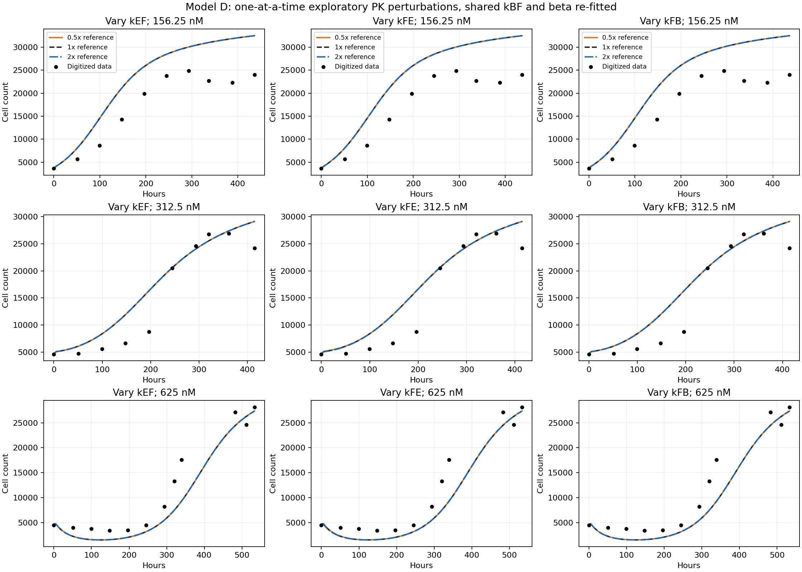
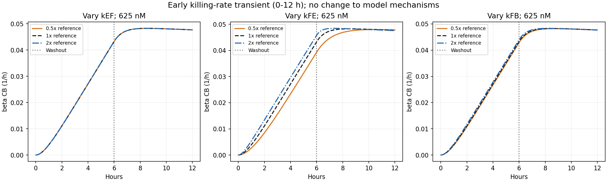

# 模型 D：固定 PK 参考值敏感性结果

在本次逐项 0.5/1/2 倍扰动范围内，重新拟合后各剂量的细胞数曲线很稳定，但估计参数明显依赖固定 PK，尤其是 beta。有效杀伤速率的长期部分也接近，早期瞬态则仍有差异。该结论限于本次设置、给药方案和观测时间范围。

## 实际运行与保持不变的条件

- 成功的 GitHub-hosted Linux MATLAB 运行：[43103720063](https://github.com/RainaYuWang/dox-pkpd/actions/runs/43103720063)，科学计算代码提交 `489f5399a298070e9503cb29373dc87615afc7af`。
- 命令 `addpath('ci'); run_pkpd_ci('sensitivity')`，内部 `run_joint_pkpd(8,true)`；MATLAB R2024b Update 10 / GLNXA64。
- MATLAB 加输出检查耗时 **183.465 秒**，包含原 A/B/C/D、124 点 D profile 及本次 9 个敏感性情形。9 个情形的拟合计时合计 **78.203 秒**；均不是整个 Actions job 的安装、排队及上传时间。
- 9 个情形 × 8 起点 = **72 个敏感性起点**，每个情形使用相同的 `314159/twister` 随机起点集合。三个 1 倍情形重新拟合，SSE、参数及输出曲线完全一致；它们是计算重复，不是实验重复。
- 通过 `pkpd-results` 分支自动读回本次状态、日志、CSV、MAT 和图像；压缩包 SHA-256 为 `18df45abc3a6c052bc6b18a317b41ac75b002229612cd220b71af67f39492d8d`。Actions REST 在当前环境仍受网络代理限制，本次回传无需手动下载或个人 token。

参考 kEF=3.5e-6、kFE=1.25、kFB=0.21 h^-1，来源为最早模型提交 `6325d45` 的 `run_joint_pkpd.m` 第 26–27 行。VI=0.004629 µL、VE=250 µL 也取自该 cfg。更早的参考 notebook 不在仓库，不能核实其校准过程；这些值不是独立实验已确定值。来源详情见 [D 定义](model_d_definition.md)。

保持 full 对照组的 kp=0.031094959444983555 h^-1、theta=35143.615284616222 cells，原数据、加权 SSE、自由参数边界、优化器设置、ODE、washout 和求解精度不变。每次只改变一个固定 PK 参数，再联合拟合跨剂量共享的 kBF、beta。A/B/C 继续保留。完整方法见 [敏感性定义](model_d_sensitivity_definition.md)。

## 最佳拟合及参数

SSE 为原目标函数：各剂量残差除以该剂量最大观测细胞数后平方求和，共 32 个处理组观测。三个 1 倍重复在下表合并为参考行；完整 9 行见 [参数与 SSE CSV](model_d_sensitivity_summary.csv)。

| 固定 PK 扰动 | 最佳 SSE | kBF (h^-1) | beta | kBF / 参考拟合 | beta / 参考拟合 |
| --- | ---: | ---: | ---: | ---: | ---: |
| 参考值 | 0.99396925 | 0.00493739 | 0.000484799 | 1.0000 | 1.0000 |
| kEF × 0.5 | 0.99396925 | 0.00493741 | 0.000969599 | 1.0000 | 2.0000 |
| kEF × 2 | 0.99396925 | 0.00493741 | 0.000242400 | 1.0000 | 0.5000 |
| kFE × 0.5 | 0.99394409 | 0.00567346 | 0.000278225 | 1.1491 | 0.5739 |
| kFE × 2 | 0.99399491 | 0.00457128 | 0.000898332 | 0.9258 | 1.8530 |
| kFB × 0.5 | 0.99396472 | 0.00458087 | 0.000899617 | 0.9278 | 1.8557 |
| kFB × 2 | 0.99397512 | 0.00564702 | 0.000277290 | 1.1437 | 0.5720 |

相对参考，SSE 最大绝对相对变化仅 **0.002581%**；这一数值比较没有进行显著性检验。kBF 变化约 **−7.4% 至 +14.9%**，beta 变化约 **−50% 至 +100%**，最大与最小 beta 相差约 **4 倍**。

每个情形内，8 个起点均返回 exitflag=1，SSE 极差最大约 7.38e-7（kFB × 0.5），其余情形极差小于 1.2e-9。72 个解均未接近原边界：kBF `[1e-7,10]`、beta `[1e-9,0.1]`。判据沿用距上下界的对数距离小于 0.02（约 2%），所有最佳解的边界标记也为 0。见 [全部起点](model_d_sensitivity_starts.csv) 和 [运行/起点诊断](model_d_sensitivity_diagnostics.json)。这支持本次多起点计算的一致性，并不证明全局最优或参数唯一。

## 各剂量细胞数曲线与残差

下表比较整个输出时间网格上的最大曲线差异：
`100 × max_t |N_扰动(t) − N_参考(t)| / max_t N_参考(t)`。
这是同剂量的模型曲线间差异，分母为参考预测峰值，不是逐时相对误差或相对实验误差。

| 固定 PK 扰动 | 156.25 nM | 312.5 nM | 625 nM |
| --- | ---: | ---: | ---: |
| kEF × 0.5 | 0.000042% | 0.000067% | 0.000146% |
| kEF × 2 | 0.000031% | 0.000070% | 0.000165% |
| kFE × 0.5 | 0.082505% | 0.205864% | 0.374711% |
| kFE × 2 | 0.050375% | 0.128034% | 0.239219% |
| kFB × 0.5 | 0.010945% | 0.022229% | 0.040833% |
| kFB × 2 | 0.014350% | 0.035211% | 0.065287% |

三剂量最大绝对变化分别约 **26.8、60.0、102.5 cells**。图中不同扰动的曲线几乎重叠，但原有数据残差仍在：156.25 nM 的中后期总体高估；312.5 nM 早中期高估；625 nM 的下降和恢复阶段也有偏差。固定 PK 扰动没有实质改善这些拟合偏差。



| 固定 PK 扰动 | SSE：156.25 nM | SSE：312.5 nM | SSE：625 nM |
| --- | ---: | ---: | ---: |
| 参考值 | 0.65618891 | 0.16670950 | 0.17107085 |
| kEF × 0.5 | 0.65618924 | 0.16670900 | 0.17107101 |
| kEF × 2 | 0.65618955 | 0.16670927 | 0.17107044 |
| kFE × 0.5 | 0.65611299 | 0.16672373 | 0.17110737 |
| kFE × 2 | 0.65622143 | 0.16669059 | 0.17108288 |
| kFB × 0.5 | 0.65615095 | 0.16677981 | 0.17103396 |
| kFB × 2 | 0.65617062 | 0.16666285 | 0.17114165 |

各剂量 SSE 与 RMSE 见 [CSV](model_d_sensitivity_by_dose.csv)；每个观测点的有符号残差和全部 N/CF/CB/E 轨迹保存在本次原始结果中。

## 有效杀伤速率 E(t)=beta·CB(t)

用 `100 × max_t |E_扰动(t) − E_参考(t)| / max_t E_参考(t)` 比较；同样避免在 E 接近 0 时计算失真的逐点相对百分比。

| 固定 PK 扰动 | 最大 E 差异，占参考峰值 | 625 nM 的 E 峰值时间 (h) |
| --- | ---: | ---: |
| 参考值 | 0 | 8.55 |
| kEF × 0.5 | 0.000212% | 8.55 |
| kEF × 2 | 0.000175% | 8.55 |
| kFE × 0.5 | 8.254623% | 10.40 |
| kFE × 2 | 5.202731% | 7.35 |
| kFB × 0.5 | 0.893187% | 8.75 |
| kFB × 2 | 1.424285% | 8.20 |

最大差异发生于早期瞬态；峰值时间来自 0.05 h 输出网格。线性 PK 使三剂量 E 随剂量成比例，上表百分比在各剂量几乎相同。24 h 之后，所有扰动的最大差异均小于参考**全时段峰值**的 0.388%；在各剂量最后观测时刻之前的 E 梯形积分，变化均小于 0.049%。这些是所用网格上的描述性比较，不是药效测量。



[各剂量完整 E 曲线](model_d_sensitivity_killing.png)；[曲线、峰值和积分指标 CSV](model_d_sensitivity_metrics.csv)。

## 为什么参数变了，细胞数曲线仍接近

线性 PK 和零初始胞内药物意味着：kEF 乘 c 时，CF、CB 同时乘 c；beta 除以 c，则 beta·CB 及细胞数方程完全不变。本次 kEF 两个扰动的 beta 正好反向补偿，曲线微小差别处于优化/数值误差量级。cell number 本身不能在这些条件下确定胞内药物浓度尺度。

kFE、kFB 扰动也能被 kBF、beta 部分补偿。PK 系统的慢衰减率 `lambda_slow = (a − sqrt(a^2−4b))/2`，其中 `a=kFE+kFB+kBF`、`b=kFE*kBF`；计算时使用等价且更稳定的 `2b/(a+sqrt(a^2−4b))`。各最佳拟合的慢衰减率仍集中在 0.00421649–0.00423932 h^-1，早期快速瞬态则可变化。这与 E 长期接近、细胞数曲线稳定而早期 E 有差异的结果一致。

因此，D 在本次扰动范围内的**已拟合细胞数轨迹较稳定**，但 **beta 的数值对固定 PK 明显敏感，kBF 也有约 15% 的条件性变化**。之前固定 PK 下的窄 kBF profile 不能当作包含固定 PK 不确定性的区间。0.5/1/2 是探索性设定，不代表实验不确定性范围；这里没有构建置信区间。cell number 为论文图像数字化数据，旧 CF+CB 为模拟值；训练数据拟合与曲线稳定均不能证明参数唯一或预测能力已获独立验证。未增加 threshold、damage-memory 或任何新机制。

## 复现与文件

计算模式、逐起点保存和 CI 检查的改动位于 `run_joint_pkpd.m`、`ci/run_pkpd_ci.m`、`.github/workflows/matlab-pkpd.yml`；本报告及 CSV/PNG 保存分析结果。新增 `ci/analyze_model_d_sensitivity.py` 从实际 MATLAB 输出重建表格和图像，不重新拟合或修改模型。

从仓库根目录复现本次取回与分析（Python 依赖 numpy>=2、scipy、matplotlib）：

```bash
python3 ci/collect_results.py --sha 489f5399a298070e9503cb29373dc87615afc7af --wait 1800
python3 ci/analyze_model_d_sensitivity.py \
  --results cloud-results/489f5399a298070e9503cb29373dc87615afc7af/43103720063-1/joint_results \
  --output reports
```

后续可手动选择 Actions 的 `sensitivity` 模式，或把相关代码提交推送到 `pkpd-sensitivity` 分支后用 collector 自动取回。文档修改及 `main` 推送不触发计算。标准 Actions artifact 名称为 `pkpd-sensitivity-43103720063-1`；Git 回传同时保留完整 MAT、每起点检查点、CSV 和日志。
