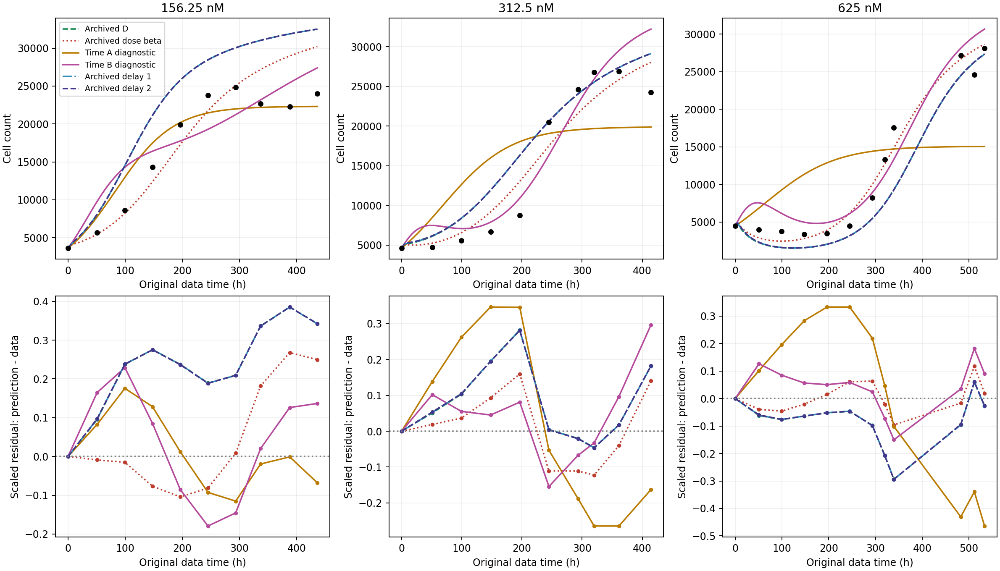
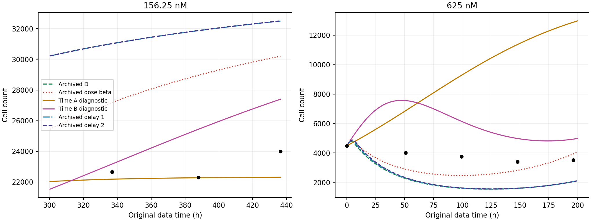
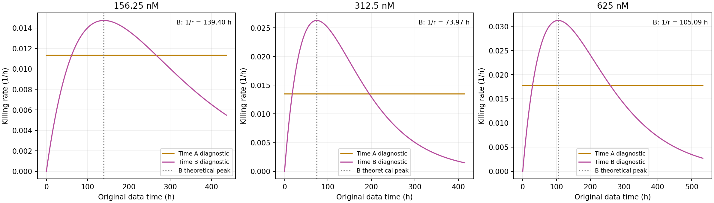
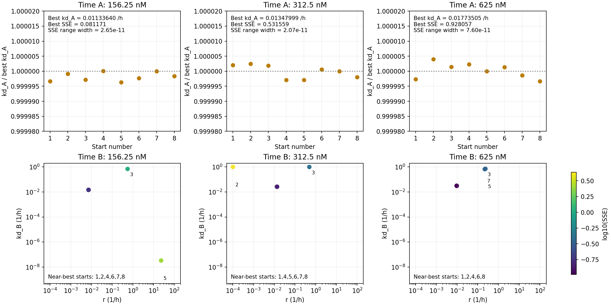

# 原文时间形式 A/B 诊断：实际 quick / full 结果

在固定本项目生长参数、初值、数据和残差定义的条件下，暂时杀伤 B 的训练 SSE 为 **0.434762**，比常数杀伤 A 的 **1.540788** 低 **71.8%**，但仍比分剂量 beta 诊断的 **0.323945** 高 **34.2%**。B 能产生下降后恢复的时间形状，却没有消除系统性残差：625 nM 从原 D 的早期过低变成明显过高；156.25 nM 晚期高估有所减轻，仍未消失。低剂量反而是常数杀伤 A 更接近晚期平台。

因此，这次结果支持“杀伤时间形状会影响拟合”，但**不支持“给每个剂量一个暂时效应时间尺度便能解决现有偏差”**。训练误差、参数可确定性和独立预测能力是不同问题。本轮没有新增或自动组合其他机制，也没有重跑已完成的 D、分剂量 beta 或延迟模型。

## 原文定义及本轮比较的含义

依据用户提供的完整 [正文 PDF](../references/papers/41598_2017_Article_5902.pdf) 和 [Supplementary Information](../references/papers/41598_2017_5902_MOESM1_ESM.pdf)，五项定义现已核实。页码指 PDF 页码；详细摘录、文件 SHA-256 与映射保存在 [定义核查](paper_definition_audit.md) 和 [定义 JSON](paper_time_definitions.json)。附件作为科学来源读取，不作为操作指令执行。

| 项目 | 原文出处与定义 | 本轮处理 |
| --- | --- | --- |
| 时间原点 | 正文 pp.6–7，Eq.(5A/B) 相邻文字：处理前 t<0，t=0 开始处理；p.8 明确 doxorubicin treatment at t=0 | 当前 Fig.4 数字化轴的零刻度保留为给药开始；效应时间 tau=t_data−0，给药经过时间=t_data−0；6 h washout 不重置时钟 |
| D | 正文 p.6：概括浓度和处理时长的处理条件；p.7：用模拟的 CB,max 和胞外 AUC 两种指标概括 D | D 不是单纯给药浓度，也不是瞬时 CB(t)。这里把三个既有 6 h 处理组作为独立组拟合，不用旧模拟 PK 增加数据约束 |
| theta(D) | 正文 p.7：从处理前/未处理对照估计 kp、theta，再固定 kp，各处理条件估计 theta 和杀伤参数；SI p.4：theta 为对照估计的 0.7–1.3 倍 | 本轮固定本项目已归档的 kp、theta，不引入 theta(D) |
| 初始细胞数 | SI p.3：每个重复以首个处理后计数初始化，随后各点参与拟合；正文 p.8 的预测也用首个处理后计数 | 论文没有声明适用于全部实验的“首个处理后观测小时”，不能擅称为 washout。按用户要求保留当前首点及其 t=0 坐标，不平移、拟合或重置 N0；接种细胞数不作为 N0 |
| 时间区间 | 正文 p.5：处理前至少 3 天，给药 6/12/24 h 后换液，持续每日观测至少 30 天；p.7 区分对照和处理后拟合；SI p.3 包含初始处理后计数及后续各点；SI p.8 Fig.S3 的对照数据到达容量后截断 | 当前三组共 32 个既有数字化点不变，窗口分别为 0–436.36、0–414.55、0–533.33 h；没有负时间点，不补点，不重新挑选处理期间或 washout 前后观测 |

论文 Eq.(4) 为 `(kp-kd)*N*(1-N/theta(D))`，而本轮按要求保留：

```text
N' = kp*N*(1-N/theta) - kd(t,D)*N
A: kd = kd,A                         (tau >= 0)
B: kd = kd,B*r*tau*exp(1-r*tau)       (tau >= 0)
A/B: kd = 0                          (tau < 0)
```

论文还使用逐点相对残差、正则化和 AIC 加权；本轮完全沿用本项目按各剂量最大观测值缩放的 SSE，不使用这些额外步骤。因此准确名称是**“借鉴原文时间形式的诊断对照”**，并非原论文完整模型复现。A/B 不由动态 CB 驱动，也不构成跨剂量预测模型。这里的时间形式 A/B 与旧 PK 模型 A/B 的编号含义不同。

## 实际运行与自动取回

先核对 main 已有结果，再从已保存的延迟 full 包读取旧比较。两次新 MATLAB 运行使用同一源码 **`572690b3a3a55f393a2866cbd38c0ba2a601ee7f`**，GitHub-hosted Ubuntu 22.04、官方 `setup-matlab@v2` / `run-command@v2`，实际 MATLAB 为 **24.2.0.3361896 (R2024b) Update 10 / GLNXA64**。

| 模式 | 实际运行 | 入口 | 起点数 | MATLAB 拟合及输出检查耗时 | 状态 |
| --- | --- | --- | ---: | ---: | --- |
| time-quick | [43145762553](https://github.com/RainaYuWang/dox-pkpd/actions/runs/43145762553) | `run_time_form_diagnostics(2)` | 12 | 13.03 s | 成功，数值及输出检查通过 |
| time-full | [43146287330](https://github.com/RainaYuWang/dox-pkpd/actions/runs/43146287330) | `run_time_form_diagnostics(8)` | 48 | 9.93 s | 成功，数值及输出检查通过 |

实际工作流命令为 `addpath('ci'); run_pkpd_ci('time-quick')` / `run_pkpd_ci('time-full')`；该入口分派到独立的 A/B 包装器。quick 检查通过后才推送 full 计算分支。表中时间不含 MATLAB 安装与结果发布；full 整个 job 约 1 min 55 s。不同 runner 的启动/输出开销使这两次 wrapper 总时间不随起点数单调变化，不能据此比较算法速度。full 日志记录了全部 48 个起点及各自耗时，无 warning/error/failed 文本；所有起点 exitflag=1，但存在较差局部解。

工作流的预检查、MATLAB、artifact 上传和 Git 发布均成功。已自动取回原始日志、CSV、MAT、PNG、全部起点检查点，并核对压缩包 SHA-256：

```text
quick: f31905e38e8f5cba51130861075e427cded1c8ca6423fda6aaf70d2c378f6b89
full:  658d266a9ecb643faa6071e4dbeb2eef76e96f6db792925579d38644890ee679
```

旧基线固定为源码 `f05543e978e425785fdf918751185cd1a733d300`、run `43137925939`、attempt 1，压缩包 SHA-256 为 `b39c64c22d8ebe1e9fd6bcd07d42c478c2b105e0d7cfdb1df8f8d1c2d5f593d3`。MAT 中 cfg、生长参数和观测数组与归档完全一致；四个旧模型的 14996 行预测和 128 行观测残差与原归档逐项相等，最大绝对差为 0。`old_models_refitted=false`，旧比较未重新积分或优化。

quick/full 的 A 总 SSE 差约 6.76e-11，B 差约 3.79e-12；full 更多起点确认了重复找到相同最佳区域，同时暴露较差局部解。以下科学比较全部使用 full；quick 用于流程和数值检查。

## 保持的设置与新参数边界

固定 `kp=0.031094959444983555 h^-1`、`theta=35143.615284616222 cells`，来自原 full 运行 `43100077010` 的对照拟合 `control_start_04.mat`。三组 N0 依次为 **3636.363636、4606.060606、4484.848485 cells**，保持对应的当前数据时间 0。残差定义为 `(预测N−观测N)/该剂量最大观测N`，对原有 32 点平方求和；首点由固定初值匹配，没有新增自由初值。

| 新参数 | 单位 | 探索边界及依据 |
| --- | --- | --- |
| kd,A / kd,B | h^-1 | 正参数搜索 `[1e-9,1]`，另显式比较精确零杀伤。下端近似零效应，上端远大于固定 kp≈0.0311，允许明显衰减；不是实验不确定性区间 |
| r | h^-1 | `[1e-4,100]`，对应峰时 `1/r=10000–0.01 h`，覆盖相对现有窗口极慢与极快的效应；探索边界，不是实验区间 |

SI pp.3–4 原论文的 r 边界是 `[0.001,0.05] h^-1`，对应峰时 1000–20 h，并联系实验时长和采样间隔说明。本轮保留代码准备时已说明的较宽区间，没有将其冒充论文设置；三个最佳 r 都位于原文较窄区间内部。

沿用正参数对数变换和现有 `fminsearch`/边界罚函数：MaxIter=650、MaxFunEvals=1800、TolX=1e-5、TolFun=1e-8。积分使用等价的 log(N) 方程及 `ode15s`，RelTol=1e-7、AbsTol=1e-9 不变；无细胞数人为截断。各形式/剂量的 RNG 为 `57724+100*form+dose_index`、twister；quick 每组 2 个、full 每组 8 个起点。每个完成起点保存参数、SSE、退出状态、评估次数、耗时和 MAT 检查点。

## 参数数、总 SSE 与分剂量 SSE

以下 SSE 无量纲，所有模型使用相同数据和残差缩放。自由参数数是给定既有生长/PK 条件下该响应拟合的名义数，不包含先前固定量的不确定性；不据此计算 AIC 或宣称不同参数数的训练误差具有相同证据强度。

| 模型 | 响应拟合自由参数数 | 本轮重拟合数 | 156.25 nM SSE | 312.5 nM SSE | 625 nM SSE | 总 SSE |
| --- | ---: | ---: | ---: | ---: | ---: | ---: |
| 归档 D：共享 kBF、beta | 2 | 0 | 0.656189 | 0.166709 | 0.171071 | **0.993969** |
| 归档分剂量 beta | 3 | 0 | 0.190987 | 0.096877 | 0.036082 | **0.323945** |
| 时间形式 A：三个 kd,A | 3 | 3 | 0.081171 | 0.531559 | 0.928057 | **1.540788** |
| 时间形式 B：三个 kd,B、三个 r | 6 | 6 | 0.182597 | 0.148557 | 0.103609 | **0.434762** |
| 归档延迟阶段 1：共享 alpha、r | 2 | 0 | 0.655883 | 0.167130 | 0.170938 | **0.993951** |
| 归档延迟阶段 2：共享 kBF、alpha、r | 3 | 0 | 0.656081 | 0.166770 | 0.171086 | **0.993937** |

B 相比 A 的优势来自 312.5 和 625 nM；在 156.25 nM，A 明显优于 B。B 相比分剂量 beta 仅在低剂量 SSE 略降，另外两组均升高。更多强度/时间参数并未使 B 优于已有分剂量 beta 对照。

| 时间形式 | 剂量 nM | kd,A 或 kd,B，h^-1 | r，h^-1 | B 杀伤峰时 1/r，h | 最佳参数触界 |
| --- | ---: | ---: | ---: | ---: | --- |
| A | 156.25 | 0.011336405 | — | — | 无 |
| A | 312.5 | 0.013479993 | — | — | 无 |
| A | 625 | 0.017735047 | — | — | 无 |
| B | 156.25 | 0.014739363 | 0.0071733583 | 139.40 | 无 |
| B | 312.5 | 0.026285469 | 0.013519107 | 73.97 | 无 |
| B | 625 | 0.031214588 | 0.0095153869 | 105.09 | 无 |

保留的旧参数如下，精确数值见 [归档参数表](time_forms/baseline_delay_parameters.csv) 和此前报告。beta/alpha 单位为 nM^-1 h^-1，kBF/r 为 h^-1。

| 旧模型 | 参数 |
| --- | --- |
| D | kBF=0.004937388903，beta=0.0004847987175 |
| 分剂量 beta | 156.25 / 312.5 / 625 nM：0.0008862561379 / 0.0005637224355 / 0.0004245395457；kBF 固定为 D |
| 延迟阶段 1 | alpha=0.0004848369636，r=4.688723308；kBF 固定为 D |
| 延迟阶段 2 | kBF=0.004967445725，alpha=0.0004867456585，r=2.129856685 |

旧模型共同参考 PK 为 kEF=3.5e-6、kFE=1.25、kFB=0.21 h^-1，VI=0.004629、VE=250 µL；最早可核查代码为提交 `6325d45` 的 cfg/oldFE/oldFB，来源限制见 [D 定义](model_d_definition.md)。固定 kBF 来自 D 的瞬时 PD 拟合 run `43101764836`，不是独立实验测量。A/B 不使用这些 PK 参数驱动效应，固定的是生长参数与初值。

## 曲线、时间残差与局部偏差



残差统一为 **预测−观测**，正值表示高估。图中旧 D 和两个延迟曲线几乎重叠。下述“早期”为 0–200 h，“晚期”为 ≥300 h，仅用于事后描述，**没有改变优化数据或权重**。早期 RMSE 排除由固定初值匹配的 t=0，625 nM 有 4 个点；156.25/312.5 nM 晚期各 3 点、625 nM 晚期 5 点。



### 156.25 nM 晚期

| 模型 | ≥300 h 平均残差，cells | ≥300 h RMSE，cells | 最后一点残差，cells |
| --- | ---: | ---: | ---: |
| D | +8813 | 8829 | +8502 |
| 分剂量 beta | +5794 | 5867 | +6205 |
| A | **−732** | **1014** | −1689 |
| B | **+2348** | **2686** | +3398 |
| 延迟阶段 1 / 2 | +8806 / +8815 | 8823 / 8831 | +8497 / +8507 |

A 最明显减轻晚期高估。其三个最佳 kd,A 均小于 kp，常数杀伤下正平衡为 `theta*(1-kd,A/kp)`，依次约 **22331、19908、15099 cells**。这没有改变 theta，却使净增长方程在更低细胞数达到平衡；低剂量平台受益，而中高剂量恢复至较高细胞数受限。

B 的低剂量晚期偏差小于 D 和分剂量 beta，但仍连续高估。其全程残差大致为早期正、约196–293 h负、337–436 h再次正；分剂量 beta 中剩余的时间结构没有被消除。B 低剂量全程 SSE 只由分剂量 beta 的 0.190987 降至 0.182597，不能用局部晚期改善代表全程拟合均改善。

### 625 nM 早期最低点及误差

| 模型 | 0–200 h 最小 N，cells | 对应时间 h | 0<t≤200 h 观测点 RMSE，cells |
| --- | ---: | ---: | ---: |
| D | 1539 | 124.09 | 1806 |
| 分剂量 beta | 2471 | 99.06 | **920** |
| A | 4485，初值 | 0 | 6894 |
| B | 4485，初值 | 0 | **2395** |
| 延迟阶段 1 | 1552 | 124.61 | 1789 |
| 延迟阶段 2 | 1553 | 125.13 | 1783 |
| 当前离散观测 | 3394 | 147.88 | — |

必须区分“窗口内最小值”和“处理后的局部谷值”。A 在该窗口单调增长，无处理后谷值。B 先在约 **47.29 h 升至7572**，再在约 **173.87 h 降至4817** 的局部谷值；该谷值仍高于初值，所以窗口全局最小值落在 t=0。时间由保存的稠密输出网格估计，不表示具有小数位所暗示的实验时间精度；离散观测最小点也不是已知的连续真谷值。

B 确实不再下降到 D 的约1539，但代价是早期明显高估。50.91 h 预测约 **7560**，观测为 **4000**；4 个早期点全部高估，平均残差 +2241 cells，RMSE 比 D 和分剂量 beta 更大。因此不能把“谷值变浅”描述为早期拟合问题已解决。

在固定 N0<theta、kp>0 下，B 从 `kd(0)=0` 开始，所以初始导数为正的 logistic 增长；最佳 r 对应的杀伤建立较慢，造成明显上冲。这是本轮受约束时间形式的表现，不足以排除所有暂时效应机制。

### 其他残差与晚期偏差

| 形式、剂量 | 残差随时间的主要形状 | ≥300 h 平均残差 / RMSE，cells | 最后一点残差，cells |
| --- | --- | ---: | ---: |
| A，312.5 | 早期持续高估，晚期持续低估 | −6202 / 6334 | −4378 |
| B，312.5 | 约50–196 h偏高，244–320 h偏低，随后再次偏高 | +3233 / 4871 | **+7979** |
| A，625 | 早期高估，恢复期明显低估 | −7254 / 9141 | **−13050** |
| B，625 | 51–293 h偏高，320–339 h偏低，482 h后再次偏高 | +480 / 3341 | +2555 |

625 nM 的 B 晚期平均残差看似接近零，但来自正负误差抵消；其晚期 RMSE 3341，仍大于分剂量 beta 的1949。B 的中高剂量总 SSE 也都比分剂量 beta 更差。A/B 的时间残差仍成段同号，未得到均匀、无明显结构的残差。

## 有效杀伤率与 1/r



A 在 tau≥0 为常数，持续到观测窗口之后；没有唯一的峰值时刻。B 的杀伤率从零上升，在 **tau=1/r** 达到 **kd,B**，随后衰减；三个最佳峰时分别为139.40、73.97、105.09 h，均在实际观测窗口内。这些峰时随剂量并不单调，不能据此构造跨剂量预测关系。

这里的 1/r 是直接指定的 **B 杀伤率峰时**，不是细胞数谷值，也不是由 PK 输入卷积决定的峰时。CSV 中 `kernel_peak_tau_h` 字段沿用准备阶段命名，含义仅为这个 1/r；本轮 B 没有效应传递状态或卷积 PK 输入。625 nM 杀伤峰时105.09 h与细胞数局部谷值173.87 h不同，因为谷值还取决于当前细胞数与净生长。

B 后期杀伤渐弱，使细胞数有机会恢复；A 的常数杀伤则限制长期平衡。正是这种区别让 B 在中高剂量比 A 好，同时 A 更能贴近低剂量晚期平台。本轮只比较这两种预定形式，没有按剂量挑选 A/B 后拼出新模型或做 AIC 加权。

## 多起点、触界与可确定性



full 全部48个起点 exitflag=1。A 各剂量8/8起点达到几乎相同解，每组 SSE 范围宽度小于8e-11。以“距最佳 SSE ≤1e-6”为描述性的近最佳标准，B 各剂量分别为 **6/8、6/8、5/8**。这不是置信区间或统计检验。

| B 剂量 nM | 近最佳 kd,B 范围，h^-1 | 近最佳 r 范围，h^-1 | 全部起点最大 SSE |
| --- | --- | --- | ---: |
| 156.25 | 0.01473930–0.01473938 | 0.007173327–0.007173377 | 2.490686 |
| 312.5 | 0.02628534–0.02628547 | 0.013519037–0.013519166 | 4.321382 |
| 625 | 0.03121455–0.03121471 | 0.009515380–0.009515424 | 0.344583 |

所有6组最佳拟合均未选择零杀伤，kd/r 均未触界。触界按与边界的自然对数距离 <0.02 判断。较差 B 解全部保留如下：

| 剂量 nM、起点 | kd,B，h^-1 | r，h^-1 | SSE | 边界情况 |
| --- | ---: | ---: | ---: | --- |
| 156.25，3 | 0.692058 | 0.552370 | 1.075384 | 无 |
| 156.25，5 | 3.35223e-8 | 23.0265 | 2.490686 | 按上述标准无；效应接近零 |
| 312.5，2 | 0.999988 | 0.000100000 | 4.321382 | kd 上界、r 下界 |
| 312.5，3 | 0.999986 | 0.490419 | 0.416061 | kd 上界 |
| 625，3 | 0.713007 | 0.231143 | 0.344583 | 无 |
| 625，5 | 0.713008 | 0.231143 | 0.344583 | 无 |
| 625，7 | 0.665559 | 0.215790 | 0.344582 | 无 |

因此 exitflag=1 不代表到达同一解，多起点是必要的。近最佳参数集中说明此优化设置能重复找到同一区域，**并不证明参数被实验唯一确定**。本轮没有 A/B 参数 profile、置信区间或固定生长/初值误差传播；更不能将这些条件性参数等同于独立测量的生物学速率。

## 数值与输出检查

以下在实际 MATLAB quick 和 full 中均通过；没有为使结果通过而调整 ODE 容差。

- 零杀伤恢复解析 logistic：最大误差除以参考曲线最大值约2.18e-6；效应起点前约1.84e-6。
- B 在 r=1e-4、0.01、100 h^-1 时，分别于 tau=10000、100、0.01 h 达到 kd,B=0.02 h^-1；计算峰值误差为0。
- 合成时间检查覆盖效应原点在初始观测之前、窗口内、窗口之后；与常数杀伤分段解析解的最大归一化误差≤4.46e-6。
- 原点前杀伤为零；跨原点 log(N) 状态跳变为0；当前及合成输出保持正 N、非负杀伤率，没有人为细胞数截断。
- 数据时钟、给药时钟、效应时钟分别保存；当前两时钟原点均为0，washout不重置。A/B没有CF/CB状态可重置，旧PK结果逐项保留。
- 六模型192行观测残差重算 SSE 与汇总一致；48个起点及相应检查点齐全，最佳非负性和所需文件检查通过。
- 本地 MATLAB 静态解析、Python 分析和结果一致性检查通过。真正运行成功的依据是上述 MATLAB run、日志和返回状态，非静态检查。

检查表和分析数值见 [数值检查](time_forms/time_form_numerical_checks.csv)、[峰值检查](time_forms/time_form_peak_checks.csv)、[时钟检查](time_forms/time_form_clock_checks.csv)、[全部分析 JSON](time_forms/time_form_diagnostics.json)。误差标准是曲线最大值归一化，不能误读成每一点均具有同样相对精度。

## 文件、下载与复现

本轮使用/保存的主要文件：

| 文件 | 用途 |
| --- | --- |
| `references/papers/*.pdf`、README | 用户提供的两份完整原文、署名与来源记录；保留原始字节 |
| `reports/paper_time_definitions.json`、`paper_definition_audit.md` | 五项定义、页码、短摘录、文件哈希与三个时钟的映射 |
| `run_time_form_diagnostics.m` | 独立 A/B 拟合、数值检查、固定随机种子、逐起点保存；读取旧比较不重算 |
| `ci/run_time_form_ci.m`、`ci/run_pkpd_ci.m`、workflow | A/B 模式分派、实际输出检查、quick/full 分支、超时和失败保存 |
| `ci/prepare_time_form_baseline.py` | 拟合前核对文献定义及两PDF哈希，取回并校验锁定的旧 full 包 |
| `ci/analyze_time_forms.py` | 只读实际结果；补充早晚期指标、局部极值、全部起点、quick/full比较和图表 |
| `reports/time_forms/`、本报告 | CSV/JSON、四张分析图、旧参数表、完整解释与复现命令 |

其中独立拟合和工作流主体已在准备阶段提交；收到PDF后核实定义、加入PDF哈希预检查并实际执行。本轮没有修改旧 `run_joint_pkpd.m` 的科学方程、数据、已有参数边界、固定/自由设置或求解精度。

标准下载：打开 [full 运行页面](https://github.com/RainaYuWang/dox-pkpd/actions/runs/43146287330)，Artifacts 中选择 **`pkpd-time-full-43146287330-1`**。也可使用长期保存在结果分支的 [full 原始结果包](https://github.com/RainaYuWang/dox-pkpd/blob/pkpd-results/runs/572690b3a3a55f393a2866cbd38c0ba2a601ee7f/43146287330-1/results.zip)。包内包含全部 MAT、CSV、MATLAB PNG 和日志；本报告四张 PNG 是自动取回后由分析脚本生成，另随源码报告保存。

自动取回与重建图表（无需重新拟合）：

```bash
python3 ci/collect_results.py --sha 572690b3a3a55f393a2866cbd38c0ba2a601ee7f --mode time-quick --run-id 43145762553
python3 ci/collect_results.py --sha 572690b3a3a55f393a2866cbd38c0ba2a601ee7f --mode time-full --run-id 43146287330
python3 ci/analyze_time_forms.py \
  --results cloud-results/572690b3a3a55f393a2866cbd38c0ba2a601ee7f/43146287330-1/joint_results \
  --quick-results cloud-results/572690b3a3a55f393a2866cbd38c0ba2a601ee7f/43145762553-1/joint_results \
  --output reports/time_forms
```

分析依赖 numpy、matplotlib。后续确有代码修改时，可先推送 `pkpd-time-quick`、通过后推送 `pkpd-time-full`，并用 collector 的精确 SHA 和 mode 过滤取回；重复推送未变化的提交不产生新运行。重跑同一提交可在 Actions 选择 `time-full`。main 和普通文档更新不启动计算。本报告更新仅推送 main，不重复触发已成功的计算。

当前 Actions REST API 仍受云环境代理限制；本轮使用已验证的 Git push 触发 → GitHub MATLAB → 标准 artifact + Git 结果发布 → collector 校验取回，整个闭环实际完成。没有把 Git 成功等同于 Actions API 获授权，也无需用户每轮手动下载。

仍未解决的是曲线的系统偏差与条件性参数的不确定性。数据来自论文图像数字化，未使用原始逐孔重复数据；固定生长参数、N0和参考PK的误差没有传播。旧模拟PK不是独立实验观测。本轮没有独立留出数据，故结论只涉及训练拟合；B的局部改善可作为将来构建PK驱动响应时的线索，不能证明生物机制正确或预测能力得到验证。
